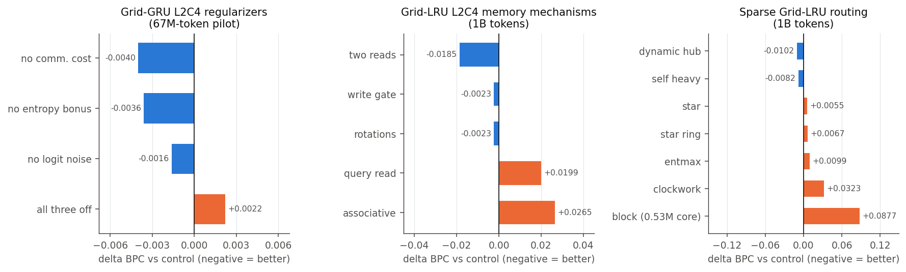

# Ablations

Every controlled ablation of the October 2026 cycle, grouped by the component that was removed or changed. Each block
compares against its own control, at the same parameter count and token or step budget. All runs are seed 42 unless
stated, so differences under about 0.005 BPC (Text8) or 0.05 return (RL) are within run-to-run noise.

Same-scale context: [AISTATS results](experiments/aistats2027_results.md). RL details: [RL experiments](experiments/rl_2026-10.md).

## Grid-GRU regularizers

MoSAIC L2C4, 67M-token pilot, compared at a shared checkpoint of 50.3M tokens. Delta = BPC minus the full model.

| Condition | BPC | delta |
|---|---:|---:|
| Full (comm. cost + entropy bonus + logit noise) | 1.9260 | +0.0000 |
| All three off | 1.9282 | +0.0022 |
| No logit noise | 1.9243 | -0.0016 |
| **No communication cost** | **1.9220** | **-0.0040** |
| No entropy bonus | 1.9224 | -0.0036 |

**Verdict: the regularizers are not needed.** Single removals slightly help, removing all three slightly hurts, and every
difference is below 0.005 BPC. The communication study therefore runs the "clean" configuration with all three off.
Caveat: an early-training pilot cannot exclude effects after 1B tokens.

## Communication and readout

Grid-GRU L2C4, 1B tokens, clean configuration. The full table and figure are in
[AISTATS results](experiments/aistats2027_results.md?id=communication-study-dynamic-vs-static-vs-none).

| Removed component | Control | Result | Verdict |
|---|---|---|---|
| Content-dependent routing (dynamic to static) | dynamic_column0 1.6006 | static 1.6004; SDQ 85.5% vs 45.7% | dynamic routing **not needed** |
| All communication (column0 readout) | static_column0 1.6004 | 1.7235, SDQ 23.3% | confounded: columns 1-3 have no path to the output |
| All communication (mean readout) | static_mean 1.6144 | none_mean 1.6452 | communication **needed** (+0.031) |
| Column-0 bottleneck (mean readout instead) | dynamic_column0 1.6006 | dynamic_mean 1.6204 | bottleneck is better on Text8 (-0.020) |
| Column-0 bottleneck on SDQ | dynamic_column0 45.7% | dynamic_mean 79.8% | mean stabilizes dynamic routing on SDQ |
| Dense routing (top-k) | dense 1.5921 | top-2 1.6353, top-1 1.8869 | dense **needed** |

## Grid-LRU memory mechanisms

Grid-LRU L2C4 H180, 1B tokens. "Late delta" averages checkpoint-aligned differences over the last part of training.
Reset-1024 resets the state every 1,024 tokens; the penalty is the BPC increase against continuous evaluation.

| Variant | BPC | delta | Late delta | Reset-1024 | Reset penalty |
|---|---:|---:|---:|---:|---:|
| control | 1.6673 | +0.0000 | +0.0000 | 1.6794 | +0.0120 |
| write gate | 1.6650 | -0.0023 | -0.0014 | 1.6771 | +0.0121 |
| query read | 1.6872 | +0.0199 | +0.0184 | 1.7009 | +0.0136 |
| associative | 1.6938 | +0.0265 | +0.0224 | 1.7121 | +0.0183 |
| rotations | 1.6651 | -0.0023 | -0.0003 | 1.6772 | +0.0122 |
| **two reads** | **1.6488** | **-0.0185** | **-0.0168** | **1.6607** | +0.0119 |

**Verdict:** a second read head per column is the only clear gain. Gated writes and rotations are neutral. Query-based
reads and an associative matrix memory hurt. The reset penalty is about 0.012 for all variants: none of them uses context
beyond 1,024 tokens more than the control does.

## Sparse Grid-LRU routing

Grid-LRU L2C4, 1B tokens, delta against the dense control (1.6761).

| Variant | BPC | delta | Idea |
|---|---:|---:|---|
| **dynamic hub** | **1.6659** | **-0.0102** | column 0 reads the others with a query; others are static |
| self heavy | 1.6680 | -0.0082 | stronger self-route initialization |
| star | 1.6816 | +0.0055 | only hub-to-leaf routes |
| star ring | 1.6828 | +0.0067 | star plus a ring between leaves |
| entmax | 1.6861 | +0.0099 | sparse entmax routing table |
| clockwork | 1.7084 | +0.0323 | columns update at different periods |
| block | 1.7638 | +0.0877 | block-diagonal projections (0.531M core, half the size) |

**Verdict:** restricting the topology costs little (star +0.006). Making the readout column query the others helps
(dynamic hub). Slowing columns down (clockwork) hurts, which repeats in RL (clockwork strides fail there too).

## Rollout length (BPTT)

67M-token pilot, compared at 50.3M tokens. Rollout 64 uses 512 streams, rollout 512 uses 64 streams (both 32,768
tokens per update).

| Model | Rollout 64 | Rollout 512 | delta |
|---|---:|---:|---:|
| GRU | 1.9826 | 2.0034 | +0.0208 |
| **Grid-GRU** | **1.9260** | **1.9464** | +0.0204 |
| Grid-LRU | 2.4867 | 2.4870 | +0.0004 |
| LRU | 2.1575 | 2.1552 | -0.0022 |

**Verdict:** longer BPTT does not help any model in this pilot. Gated models lose 0.02 BPC because fewer independent
streams per update hurt more than the longer gradient window helps. The same holds in RL (bptt 256: grid -0.435 vs
-0.458, LRU -0.369 vs -0.415 on AutoencodeMedium, both still failing).

## RL ablations (Grid-LRU on AutoencodeEasy)

PPO, 20M steps, ~1M parameters, seed 42. Metric: greedy eval return, mean of the last five evaluations (max 1.0). Each row
removes or changes one component of the configuration it names. Full list and curves: [RL experiments](experiments/rl_2026-10.md).

| Component | With | Without / changed | Verdict |
|---|---:|---:|---|
| `x_add` (observation added to every layer-0 column), dynamic L2C4 | 0.821 | 0.101 | **essential** |
| dynamic routing (vs static table), L2C4 + `x_add` | 0.821 | 0.175 | **essential** |
| dynamic routing (vs `table`: same projections, fixed weights) | 0.821 | 0.102 | content-dependent weights are what matters |
| recurrent feedback of top outputs, L1C4 | 0.918 | -0.162 | **essential** |
| column horizon bands, L2C4 dynamic | 0.875 | 0.821 | helps (+0.05, confirmed on 3 seeds) |
| column horizon bands, L1C4 | 0.918 | 0.823 | helps (+0.10) |
| horizon band order (reverse) | 0.875 | 0.849 | order irrelevant |
| horizon bands with static routing | 0.175 | 0.058 | helps only with dynamic routing |
| second layer (L2C4 vs L1C4, colhz) | 0.918 | 0.875 | one layer is better |
| silu on cell output, L1C4 | 0.918 | 0.821 (linear) | small loss; transfer collapses (-0.086) |
| column 0 readout vs all columns, L1C4 | 0.918 | 0.623 | column-0 bottleneck is better |
| one communication round vs 2 / 3 | 0.821 | 0.298 / 0.067 | extra rounds hurt monotonically |
| dense routing vs `route_topk=2` | 0.821 | 0.788 | neutral |
| aux loss predicting past observations | 0.875 | 0.874 (coef .1), 0.810 (coef 1) | neutral |
| routing entropy bonus / penalty, L2C4 colhz | 0.875 | 0.681 / 0.551 | both hurt |
| per-column weights vs shared projections | 0.875 | 0.819 | small loss |

## What was not ablated

- The regularizer ablation exists only as a 67M-token pilot and one seed. A 1B-token, multi-seed version was not run.
- SDQ none_mean (the key no-communication control on SDQ) was paused at 477M tokens (26.2%).
- The single-column L2C1 control was paused at 333M tokens.
- No ablation of the column identities (`ids`) or the per-column temperature of the router.
