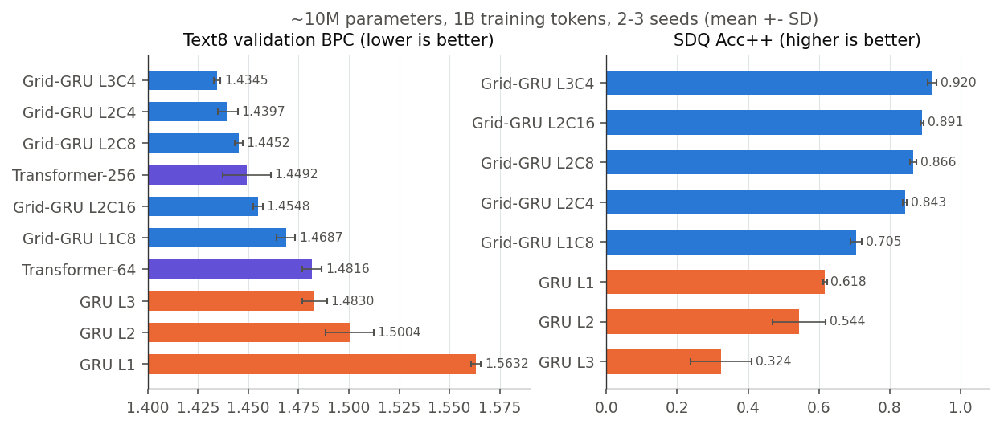
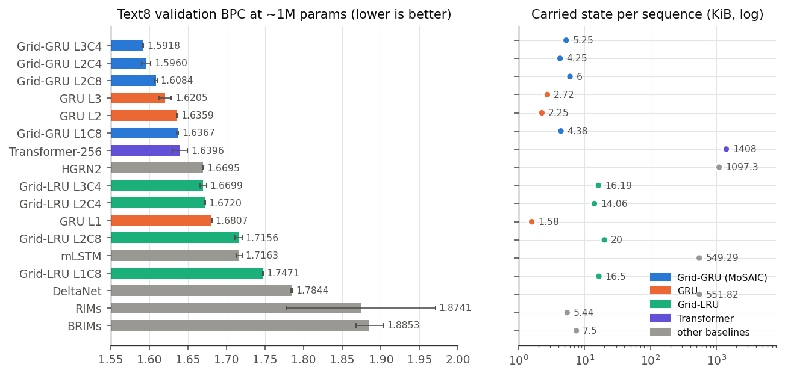
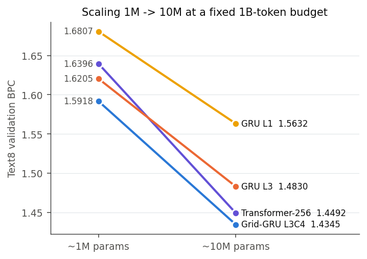
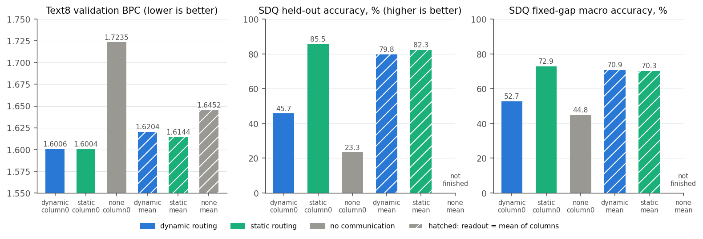

# AISTATS 2027: full experimental results

All results behind the AISTATS 2027 resubmission of MoSAIC (Grid-GRU), collected in one place. The numbers are the ones in
the paper tables (`article/latex/aistats_*.tex`, generated by `inference/aistats_revision_evidence.py`,
`inference/aistats_reporting_checks.py` and `inference/aistats_resource_accounting.py`) plus the later communication
study. Architectures: [Grid-GRU](methods/grid_gru.md), [Grid-LRU](methods/grid_lru.md).

Notation: BPC = bits per character on Text8 (lower is better). SDQ Acc++ = Store-Distract-Query accuracy (higher is
better). Mean +- sample SD over seeds; "1 seed" rows have no uncertainty estimate. Bold = best observed.

Related pages: [Ablations](experiments/ablations.md), [RL experiments](experiments/rl_2026-10.md),
[Hypothesis registry](experiments/hypotheses.md), raw reports [H100 2026-10-12](experiments/h100_2026-10-12/report.md),
[communication 2026-10-13](experiments/communication_2026-10-13/report.md).

## Summary

| Question | Answer |
|---|---|
| Does Grid-GRU beat a parameter-matched GRU? | Yes at 10M on Text8 (-0.049 BPC, p = 0.003) and SDQ (+0.30 Acc++). At 1M the direction holds, p = 0.08 to 0.12. |
| Does it beat a Transformer? | Comparable: -0.015 BPC at 10M, not significant (p = 0.165). Uses about 270 times less state. |
| Does Grid-LRU replace Grid-GRU? | No. At 1M every Grid-LRU configuration is 0.07 to 0.11 BPC worse than the same Grid-GRU shape. |
| Are the routing regularizers needed? | No. Each changes BPC by less than 0.005 in the pilot. |
| Is routing by content needed? | Not shown. A static learned table matches dynamic routing on Text8 and is better on SDQ. |
| Is communication needed at all? | Probably yes (1 seed): no-communication with a mean readout is 0.03 BPC worse than static. |
| Best non-grid reference | Mamba, 1.5651 BPC at ~1M (2 seeds), better than every Grid-GRU. |

## 10M parameters (Text8 and SDQ)

1B training tokens, 3 seeds per row unless stated. SDQ uses the mean of the last five online measurements per run.



| Model | Params | Text8 n | Val. BPC | SDQ Acc++ |
|---|---:|---:|---:|---:|
| GRU-L1 | 10.16M | 3 | 1.5632 +- 0.0025 | 0.6177 +- 0.0052 |
| GRU-L2 | 10.04M | 3 | 1.5004 +- 0.0119 | 0.5444 +- 0.0743 |
| GRU-L3 | 10.23M | 3 | 1.4830 +- 0.0061 | 0.3241 +- 0.0862 |
| MoSAIC-L1C8 | 10.11M | 3 | 1.4687 +- 0.0046 | 0.7051 +- 0.0163 |
| MoSAIC-L2C4 | 10.11M | 3 | 1.4397 +- 0.0050 | 0.8433 +- 0.0055 |
| MoSAIC-L2C8 | 10.17M | 3 | 1.4452 +- 0.0019 | 0.8664 +- 0.0099 |
| MoSAIC-L2C16 | 10.09M | 2 | 1.4548 +- 0.0023 | 0.8911 +- 0.0049 |
| **MoSAIC-L3C4** | 9.99M | 3 | **1.4345 +- 0.0017** | **0.9204 +- 0.0128** |
| Transformer-256 | 10.07M | 3 | 1.4492 +- 0.0120 | --- |
| Transformer-64 | 10.07M | 3 | 1.4816 +- 0.0049 | --- |

Observations:

- Deeper GRUs get better on Text8 but **worse on SDQ** (0.62 to 0.32): the GRU trades memory for language modeling.
  Grid-GRU improves on both axes at the same time.
- More columns at fixed depth help SDQ (L2C4 0.843, L2C8 0.866, L2C16 0.891) but not Text8.
- L1C8 is the weakest grid: one layer gives no within-step computation between routing rounds.

## 1M parameters (Text8)

1B tokens. Width chosen per model so that every model has about 1M parameters including the token adapters (`V = 27`).



| Model | Width | Params | Runs | Val. BPC | Test BPC | State floats | KiB |
|---|---:|---:|---:|---:|---:|---:|---:|
| **MoSAIC L3C4** | 112 | 1.069M | 3 | **1.5918 +- 0.0009** | **1.6590** | 1,344 | 5.25 |
| MoSAIC L2C4 | 136 | 1.050M | 3 | 1.5960 +- 0.0058 | 1.6636 +- 0.0056 | 1,088 | 4.25 |
| MoSAIC L2C8 | 96 | 0.973M | 2 | 1.6084 +- 0.0017 | 1.6730 | 1,536 | 6.00 |
| MoSAIC L1C8 | 140 | 1.034M | 2 | 1.6367 +- 0.0013 | 1.7030 | 1,120 | 4.38 |
| GRU L1 | 404 | 1.004M | 2 | 1.6807 +- 0.0003 | 1.7415 | 404 | 1.58 |
| GRU L2 | 288 | 1.014M | 3 | 1.6359 +- 0.0007 | 1.6966 +- 0.0002 | 576 | 2.25 |
| GRU L3 | 232 | 0.986M | 2 | 1.6205 +- 0.0080 | 1.6814 +- 0.0068 | 696 | 2.72 |
| Grid-LRU L1C8 | 176 | 1.004M | 2 | 1.7471 +- 0.0002 | 1.8116 | 4,224 | 16.50 |
| Grid-LRU L2C4 | 180 | 1.049M | 3 | 1.6720 +- 0.0006 | --- | 3,600 | 14.06 |
| Grid-LRU L2C8 | 128 | 1.060M | 2 | 1.7156 +- 0.0047 | --- | 5,120 | 20.00 |
| Grid-LRU L3C4 | 148 | 1.063M | 3 | 1.6699 +- 0.0042 | 1.7301 +- 0.0002 | 4,144 | 16.19 |
| Transformer-256 | 176 | 1.002M | 2 | 1.6396 +- 0.0098 | --- | 360,448 | 1408.00 |
| HGRN2 | 153 | 0.996M | 2 | 1.6695 +- 0.0005 | --- | 280,908 | 1097.30 |
| mLSTM | 216 | 0.996M | 2 | 1.7163 +- 0.0039 | --- | 140,619 | 549.29 |
| DeltaNet | 217 | 1.004M | 2 | 1.7844 +- 0.0012 | 1.8403 | 141,267 | 551.82 |
| RIMs | 696 | 0.995M | 2 | 1.8741 +- 0.0965 | 1.9333 +- 0.0991 | 1,392 | 5.44 |
| BRIMs | 480 | 1.000M | 2 | 1.8853 +- 0.0179 | 1.9389 +- 0.0189 | 1,920 | 7.50 |

Mamba (2 seeds, H100 snapshot at 980M tokens): **1.5651 +- 0.0012** val BPC, the best model at this scale. It was added late
and is not in the paper's main table. Test values are the validation-selected checkpoints; "---" means no test evaluation
was run, not a zero.

Observations:

- At 1M the Grid-GRU ranking is L3C4 < L2C4 < L2C8 < L1C8, the same as at 10M.
- **RIMs and BRIMs** (the closest modular baselines, asked for by the AAAI reviewers) are the worst models, with unstable
  seeds (RIMs SD 0.097).
- Linear-attention and matrix-memory models (HGRN2, mLSTM, DeltaNet) carry 100 to 300 times more state than Grid-GRU and
  are still worse on Text8.
- **Grid-LRU at the same shape is consistently worse than Grid-GRU** (L2C4: 1.6720 vs 1.5960), although it carries 3.3
  times more state.

### Scaling from 1M to 10M



The Grid-GRU advantage over GRU grows with scale (1M: -0.029, 10M: -0.049 BPC against the best GRU). The Transformer
gains more from scale than the GRU, and ends 0.015 BPC behind Grid-GRU.

## Uncertainty checks

Exploratory Welch tests on final scores, nominal 95% intervals, no multiplicity correction.

| Scale | Task | Model | Reference | Diff. | df | p | 95% interval |
|---|---|---|---|---:|---:|---:|---|
| 10M | Text8 | MoSAIC-L2C4 | GRU-L3 | -0.0433 | 3.87 | <0.001 | [-0.0561, -0.0305] |
| 10M | Text8 | MoSAIC-L3C4 | GRU-L3 | -0.0485 | 2.32 | 0.003 | [-0.0622, -0.0348] |
| 10M | SDQ | MoSAIC-L2C4 | GRU-L1 | +0.2255 | 3.99 | <0.001 | [+0.2134, +0.2376] |
| 10M | SDQ | MoSAIC-L3C4 | GRU-L1 | +0.3026 | 2.64 | <0.001 | [+0.2751, +0.3302] |
| 10M | Text8 | MoSAIC-L2C4 | Transformer-256 | -0.0095 | 2.68 | 0.304 | [-0.0352, +0.0161] |
| 10M | Text8 | MoSAIC-L3C4 | Transformer-256 | -0.0147 | 2.08 | 0.165 | [-0.0438, +0.0143] |
| 10M | Text8 | MoSAIC-L2C4 | MoSAIC-L2C8 | -0.0055 | 2.58 | 0.190 | [-0.0164, +0.0054] |
| 10M | Text8 | MoSAIC-L3C4 | MoSAIC-L2C4 | -0.0052 | 2.46 | 0.208 | [-0.0163, +0.0059] |
| 1M | Text8 | MoSAIC-L2C4 | GRU-L3 | -0.0246 | 1.71 | 0.082 | [-0.0579, +0.0088] |
| 1M | Text8 | MoSAIC-L3C4 | GRU-L3 | -0.0287 | 1.02 | 0.122 | [-0.0983, +0.0409] |

Only the GRU comparisons at 10M are significant. The Transformer comparison and the comparison between grid shapes are
not.

## Communication study (dynamic vs static vs none)

L2C4, H136, about 1M params, seed 42, clean configuration (no regularizers, no logit noise), 1B tokens. The three routing
modes share all weights: `static` computes Q/K only from the column identities, `none` masks every off-diagonal route.
Two readouts: column 0 only, or the mean of the four top columns.



| Condition | Text8 val | Text8 test | SDQ held-out | SDQ fixed-gap macro |
|---|---:|---:|---:|---:|
| dynamic, column0 | 1.6006 | 1.6662 | 45.71% | 52.68% |
| **static, column0** | **1.6004** | **1.6653** | **85.54%** | **72.89%** |
| none, column0 | 1.7235 | 1.7805 | 23.32% | 44.80% |
| dynamic, mean | 1.6204 | 1.6825 | 79.79% | 70.88% |
| static, mean | 1.6144 | 1.6791 | 82.26% | 70.27% |
| none, mean | 1.6452 | 1.7055 | not finished | --- |

What it shows:

1. **Dynamic and static routing are equal on Text8** (1.6006 vs 1.6004). Content-dependent routing gives no measurable
   gain in this seed.
2. **On SDQ, dynamic routing with a column-0 readout is unstable.** It peaked at 66.0% around 840M tokens and fell to
   45.7% at the end; static stays at 85.5%. A mean readout recovers dynamic to 79.8%.
3. **No communication is clearly worse** even when all columns are read (none_mean 1.6452 vs static_mean 1.6144). The
   columns need to exchange information, not just exist in parallel.
4. Long gaps tell a different story: at gap 512, dynamic_mean keeps 30.3% against 5.0% for static_column0.
5. A single wide column (L2C1, 456 state floats) at 320M tokens reaches 1.6920, close to static_mean at the same point
   (1.6921). The number of columns alone does not determine quality (run paused, not a final result).

Figures from the original reports: [learning curves](experiments/communication_2026-10-13/main_plots/01_learning.png ":ignore"),
[final quality](experiments/communication_2026-10-13/main_plots/02_final_quality.png ":ignore"),
[memory gaps](experiments/communication_2026-10-13/main_plots/03_memory_gaps.png ":ignore").

### Memory diagnostics (lesions and probes)

Frozen final checkpoints, extra linear probes trained on CPU. Lesion = zero both layers of one column right before the
token.

| Condition | delta BPC C0 | C1 | C2 | C3 |
|---|---:|---:|---:|---:|
| dynamic_column0 | +0.864 | +0.486 | +0.365 | +0.406 |
| static_column0 | +0.524 | +0.464 | +0.485 | +0.441 |
| none_column0 | +2.094 | +0.000 | +0.000 | +0.000 |
| dynamic_mean | +0.391 | +0.456 | +0.352 | +0.475 |
| static_mean | +0.382 | +0.369 | +0.376 | +0.391 |

- With a column-0 readout, columns 1 to 3 still matter (+0.37 to +0.49 BPC when removed): they work as memory that
  column 0 reads through the router.
- In SDQ dynamic_column0, a linear probe on column 0 recovers 49.3% against 39.9% for the native head: part of the
  failure is the decoder, but the probe does not reach static (84.6%).
- CKA between columns 2 and 3 in SDQ dynamic_column0 is 0.92: two of the four memories are nearly redundant.


Full report: [communication diagnostics](experiments/communication_diagnostics_2026-10-12_selected/report.md).

## Sparse routing (top-k)

Grid-GRU L2C4 at 1M, Text8, 980M tokens, seed 42.

| Routing | BPC |
|---|---:|
| **dense** | **1.5921** |
| top-2 | 1.6353 |
| top-1 | 1.8869 |

Hard top-1 routing loses 0.29 BPC. Each column needs to mix at least two sources.


## Grid-LRU pilots

The Grid-LRU mechanism and sparse-routing pilots, the regularizer ablation and the rollout pilot are on
[Ablations](experiments/ablations.md). Short version: two read heads (-0.0185 BPC) and a dynamic hub (-0.0102) help; query reads,
associative memory, clockwork and block sparsity hurt.

## MQAR (associative recall)

Grid-LRU variants, seed 42, 173.6M tokens. Query-weighted accuracy (%), cross-entropy (nats), then accuracy per
(sequence length / number of pairs) bin. Every sequence-level exact match is zero.

| Variant | Overall | CE | 64/4 | 128/8 | 256/16 | 256/32 | 256/64 |
|---|---:|---:|---:|---:|---:|---:|---:|
| **control** | **2.700** | 7.838 | 24.825 | **11.388** | **4.519** | **1.969** | 0.142 |
| write gate | 2.357 | **7.412** | **25.500** | 10.400 | 3.363 | 0.969 | **0.348** |
| query read | 0.023 | 8.322 | 0.025 | 0.037 | 0.006 | 0.041 | 0.017 |
| associative | 2.059 | 8.506 | 23.225 | 9.488 | 3.631 | 0.847 | 0.020 |
| rotations | 1.738 | 7.678 | 22.350 | 7.587 | 2.044 | 0.653 | 0.184 |
| two reads | 1.743 | 7.721 | 22.150 | 7.600 | 1.975 | 0.637 | 0.230 |

**Negative result.** No Grid-LRU variant solves MQAR beyond the shortest bin (about 25% at 64/4). The query-read variant
collapses completely. MQAR is out of reach for these models at this budget, and the paper reports it only as a pilot.


## RL pilots in the paper

POPGym, seed 42, mean return over four late evaluations (32 episodes each).

| Environment | GRU | LRU | Grid-GRU | Grid-LRU | dynamic hub | two reads |
|---|---:|---:|---:|---:|---:|---:|
| RepeatPreviousHard | -0.5161 | **-0.3809** | -0.4942 | -0.4973 | -0.4963 | -0.4927 |
| AutoencodeEasy | -0.4964 | **-0.4663** | --- | --- | -0.5072 | -0.5111 |

**Negative result.** All models stayed near the random-policy return. The follow-up study found that these two tasks
were beyond reach for every GRU-style model at this budget, and that the grid diluted the observation. See
[RL experiments](experiments/rl_2026-10.md), where a redesigned Grid-LRU reaches 0.918 on AutoencodeEasy.


## Training cost (H100)

1B-token budget, per-run loop time (includes overhead) and effective rate.

| Task | Model | n | Loop time (h) | Rate (k tokens/s) |
|---|---|---:|---:|---:|
| SDQ | MoSAIC-L2C4 | 1 | 1.327 | 209.3 |
| SDQ | MoSAIC-L3C4 | 3 | 1.946 +- 0.311 | 145.4 +- 25.1 |
| SDQ | GRU-L2 | 1 | 0.984 | 282.2 |
| Text8 | MoSAIC-L2C4 | 2 | 1.627 +- 0.236 | 172.5 +- 25.1 |
| Text8 | MoSAIC-L3C4 | 3 | 2.264 +- 0.033 | 122.7 +- 1.8 |
| Text8 | GRU-L2 | 2 | 1.097 +- 0.016 | 253.1 +- 3.6 |
| Text8 | Transformer-256 | 1 | 0.571 | 486.1 |

Grid-GRU costs 1.5 to 2 times the GRU wall time at the same parameter count, mostly from the per-layer router. Detailed
accounting: [resources](experiments/aistats2027_resources.md).

## Reproducing

```sh
uv run python inference/aistats_revision_evidence.py      # paper tables from the Comet snapshot
uv run python inference/aistats_reporting_checks.py       # test BPC and Welch checks
uv run python inference/docs_figures_2026_10.py           # figures on this page and the RL page
```
