# Коммуникация MoSAIC: простая постановка и текущие результаты

Основные результаты и первые три графика обновлены по данным 13 октября 2026: **11 завершённых запусков из 16**, два приостановлены с сохранением checkpoint, три ещё не начаты. Все обучения остановлены по просьбе пользователя. На кривых обучения приостановленные запуски отмечены чёрным пунктиром; в итоговые сравнения включены только завершённые обучения.

Подробный анализ новых результатов, частичных запусков и сравнений при равном промежуточном бюджете: [отчёт за 13 октября](../communication_2026-10-13/report.md). Диагностики CKA, чтения памяти и вкладов колонок ниже относятся к прежним девяти checkpoints; два новых завершённых запуска в них ещё не включены. Краткие объяснения всех вариантов: [справочник вариантов](../communication_variant_reference.md). Конфиги очереди и команды: [config/README.md](../../../knitwork/exps/communication/config/README.md).

## Что проверяем

У модели есть четыре колонки памяти, каждая состоит из двух последовательно работающих GRU-ячеек. На каждом шаге она получает новый символ или событие, обновляет память и делает предсказание. Мы меняем только правила обмена между колонками и способ, которым предсказание читает их память. Вопрос: помогает ли само общение колонок, нужно ли выбирать связи по текущему содержимому памяти и достаточно ли просто открыть предсказанию всю память?

На **Text8** нужно предсказать следующий символ текста. Ошибка измеряется в BPC: меньше лучше. Текст разделён на 90M символов обучения, 5M validation и 5M test. Validation и test проходят непрерывно, без случайных сбросов памяти; test читается после обучения.

В **SDQ** модель запоминает пары «ключ — значение», встречает отвлекающие события и отвечает на запросы. Правильный ответ учитывает также счётчики store/query и накопленные отвлекающие значения, поэтому это задача вычисления с памятью, а не простого копирования. Основная оценка — доля правильных ответов на отдельном неизменном генераторе. Дополнительная проверка задаёт расстояния 8, 32, 128, 256 и 512 шагов; нужная запись там не перезаписывается.

## Что одинаково

Топология L2C4, ширина каждой ячейки 136, четыре attention-heads. Около 1M весов: Text8 **1 050 499**, SDQ **1 053 338**, включая вход и prediction head. На один поток выделено **1088 чисел recurrent state**. Все условия внутри задачи начинают с одинаковых весов; seed модели и данных равен **42**. Нет routing noise, штрафа коммуникации и entropy bonus: это рецепт `clean`.

Каждому завершённому запуску дано около **1B training tokens**. Batch — 512 потоков; градиент проходит через 64 шага для Text8 и 32 для SDQ. Поэтому фактические бюджеты составляют 999 981 056 / 999 997 440 токенов и 30 517 / 61 035 updates. Optimizer RMSprop, clipping нормы до 1, одинаковое расписание LR внутри задачи. SDQ постепенно усложняется до T=500; оценка с самого начала использует фиксированный T=500. Проверка качества каждые 20M токенов, локальные метрики примерно каждые 5M.

## Как реализованы dynamic, static и none

**Dynamic — общение зависит от того, что сейчас хранится.** К текущим сообщениям добавляются обучаемые идентификаторы колонок. Из этих сумм линейные Q/K-проекции и SiLU строят запросы и ключи; V-проекция переносит само содержимое сообщения. Q и K определяют attention-веса. Чем изменилось содержимое памяти, тем могут измениться связи. Это исходный production `StochasticMessagePassingLayer`.

**Static — связи обучаются, но не зависят от текущего содержимого.** Q и K строятся только из обучаемых идентификаторов колонок. V по-прежнему содержит текущую память или вход. Во время обучения веса связей могут меняться вместе с параметрами. При фиксированных параметрах один и тот же маршрут используется для любого текста или события. Это не замороженная случайная матрица и не простое равное усреднение. Полные проекции пересчитываются на каждом шаге, без кэширования.

**None — колонки не читают состояние друг друга.** Сначала вычисляются те же dense-проекции. Затем перед softmax маска закрывает межколоночные связи. В нижнем слое каждой колонке доступны внешний ввод и собственное задержанное состояние верхнего слоя; выше — только сообщение собственной колонки снизу. Локальное смешивание ввода и собственной памяти остаётся обучаемым и зависит от содержимого. Общие веса проекций не означают обмен состояниями. Отключается именно межколоночный обмен, а не весь attention.

Во всех трёх режимах после смешивания работают одинаковые выходная проекция, LayerNorm и GRU-ячейки. Везде четыре heads. В текущих `clean` запусках шум и вспомогательные штрафы равны нулю.

Если нужны точные формулы, для каждой attention-head в текущем clean-режиме:

```text
dynamic: q = SiLU(Wq · (h_prev + id_q) + bq)
         k = SiLU(Wk · (message + id_k) + bk)
static:  q = SiLU(Wq · id_q + bq)
         k = SiLU(Wk · id_k + bk)
both:    v = SiLU(Wv · message + bv)
         score = softplus(temp) · (q @ k.T) / sqrt(head_dim)
none:    запрещённым межколоночным score присваивается −∞
         остальные score строятся как в dynamic
all:     weights = softmax(score)
         msg = LayerNorm(Wo · concat_heads(weights @ v) + bo)
         h_next = GRU(msg, h_prev)
```

В нижнем слое `message` содержит предыдущие верхние состояния всех колонок и текущий внешний ввод. В верхнем слое — свежие состояния нижнего слоя. При none маска оставляет только свою колонку; внешний ввод доступен каждой колонке нижнего слоя. Здесь head_dim = 136 / 4 = 34.

Код: [production Grid и dynamic router](../../../knitwork/models/grnn_core.py), [static/none и readout](../../../knitwork/models/grnn_communication.py). Это matched-контроль с четырьмя heads, а не отдельный старый класс `StaticMessagePassingLayer`, у которого другая конструкция.

**Чтение column0:** prediction head получает только верхнюю память колонки 0. **Чтение mean:** получает среднее верхних состояний всех четырёх колонок. Mean не добавляет весов и не возвращает смесь назад в recurrent state.

## Каждая ablation

| Условие | Что меняем | Какой вопрос задаём | Завершено |
|---|---|---|---|
| `dynamic_column0` | Исходные dynamic-связи; читаем колонку 0 | Опорный communicating grid | Text8, SDQ |
| `static_column0` | Q/K только из идентификаторов; читаем колонку 0 | Нужно ли менять связи по содержимому? | Text8, SDQ |
| `none_column0` | Запрещаем межколоночные связи; читаем колонку 0 | Что происходит при потере доступа к остальным колонкам? | Text8, SDQ |
| `dynamic_mean` | Dynamic-связи; читаем среднее всех колонок | Меняет ли результат доступ head ко всей верхней памяти? | Text8, SDQ |
| `static_mean` | Static-связи; читаем среднее всех колонок | Нужны ли dynamic-связи, когда вся память доступна head? | Text8, SDQ |
| `none_mean` | Нет межколоночного обмена; читаем все колонки через mean | Достаточно ли независимой памяти без общения? | Только Text8; SDQ приостановлен |

**Особенность none_column0:** остальные три колонки не имеют пути к предсказанию. Выделено 1088 state-чисел, но к ответу могут повлиять только 272. Его проигрыш может объясняться потерей доступной памяти. Главный контроль, который снимает эту проблему, — `none_mean`: Text8 уже завершён, SDQ приостановлен на 477 560 832 токенах. Одноколоночный Text8 L2C1 приостановлен на 333 250 560 токенах; это отдельный контроль с 456 активными state-числами.

Полные dense matrix products совпадают: примерно 3,06M forward FLOPs/token внутри каждой задачи; matching проверялся также для dense forward/backward. Softmax, elementwise операции, optimizer и эффективное число параметров с ненулевым task gradient этим не уравнены. Мы не делаем из номинального равенства весов вывод о равной полезной ёмкости.

## Итоговые числа

| Условие | Text8 val BPC ↓ | Text8 test BPC ↓ | SDQ held-out accuracy ↑ | SDQ fixed-gap macro ↑ |
|---|---:|---:|---:|---:|
| `dynamic_column0` | 1.6006 | 1.6662 | 45.71% | 52.68% |
| `static_column0` | 1.6004 | 1.6653 | 85.54% | 72.89% |
| `none_column0` | 1.7235 | 1.7805 | 23.32% | 44.80% |
| `dynamic_mean` | 1.6204 | 1.6825 | 79.79% | 70.88% |
| `static_mean` | 1.6144 | 1.6791 | 82.26% | 70.27% |
| `none_mean` | 1.6452 | 1.7055 | — | — |

«—» означает отсутствие завершённого результата. Это не ноль. Итоговые числа относятся к последнему checkpoint после полного бюджета, а не к лучшей точке кривой.

## Что уже видно

На Text8 `dynamic_column0` и `static_column0` практически совпали: 1,6006 и 1,6004 BPC. В варианте mean static также немного ниже: 1,6144 против 1,6204. В этом seed преимущества изменения маршрутов по содержимому не наблюдаем.

На SDQ `static_column0` дал 85,54% held-out accuracy, `dynamic_column0` — 45,71%: static выше на **39,83 процентного пункта**. Чтение всей памяти у dynamic подняло результат до 79,79%, то есть на **34,08 пункта** относительно column0. Это описательные разницы конкретных запусков, а не проверка статистической значимости.

У SDQ dynamic/column0 качество заметно меняется ближе к концу: лучшая записанная held-out accuracy — 66,01% около 840M, финальная — 45,71%. Поэтому итог по последнему checkpoint и лучший результат за всё обучение — разные критерии. Основной итог здесь финальный; график не скрывает ухудшение.

None/column0 хуже communicating-вариантов: Text8 1,7235 BPC, SDQ 23,32%. Из-за недоступности остальных колонок это само по себе ещё не доказательство необходимости общения. Новый Text8 none_mean даёт 1,6452 BPC: чтение всей независимой памяти улучшило качество, но осталось хуже dynamic_mean на 0,0247 и static_mean на 0,0307 BPC. Это описательные данные в пользу обмена при одинаковом readout mean и номинальном state; преимущества dynamic над static не видно. На SDQ static_mean завершён с 82,26%: выше dynamic_mean на 2,47 процентного пункта, ниже static_column0 на 3,28 пункта. Главный SDQ-контроль none_mean ещё не завершён.

Проверки дальних gaps дают другую картину, чем общая accuracy. Например, на gap=512 dynamic/mean даёт 30,27%, static/column0 — 4,98%, dynamic/column0 — 3,32%. Static/column0 лучше по коротким и средним gaps и по общей accuracy, но это не универсальное преимущество на всех расстояниях.

## Графики и как их читать

### Как меняется качество по мере обучения

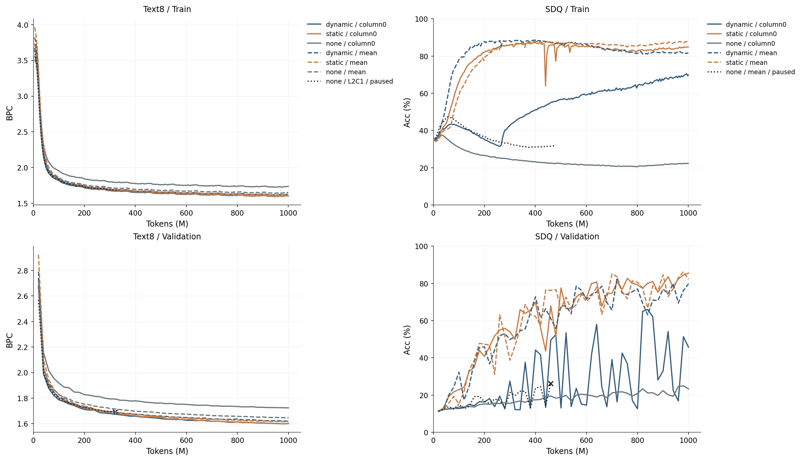

Основная серия L2C4, около 1M параметров, clean, seed 42. Добавлены завершённые Text8 none_mean и SDQ static_mean. Чёрным пунктиром показаны приостановленные SDQ none_mean и одноколоночный Text8 L2C1; их последние validation предшествуют checkpoint остановки. SDQ train меняет сложность по curriculum, validation всегда использует T=500. X validation восстановлен по расписанию; полос неопределённости нет.

### Финальное качество: одинаковый бюджет около 1B токенов

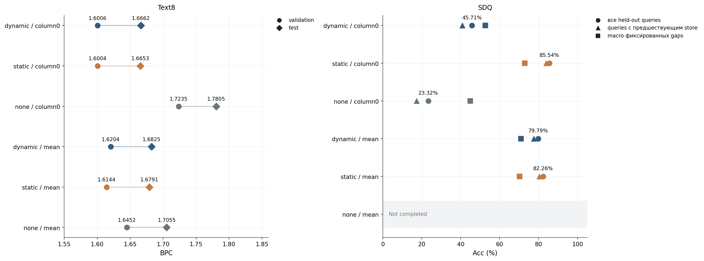

L2C4, около 1M параметров, clean, seed 42. Только завершённые запуски; полос неопределённости нет. Отсутствующие условия показаны серым; это не нулевой результат. Точки с разными маркерами измеряют разные критерии.

### Как далеко модель сохраняет полезную память

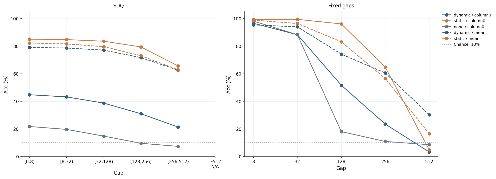

L2C4, около 1M параметров, clean, seed 42. Только завершённые запуски; полос неопределённости нет. Слева реальные queries с известным store; counts: 17130 / 41872 / 51513 / 6286 / 393 / 0. Справа 1024 примера на gap.

### SDQ: финальное качество и устойчивость траектории

Дополнительные графики 4–7 ниже сохраняют исторический срез за 12 октября: девять завершённых запусков. Новые результаты отражены в первых трёх графиках и в [отчёте за 13 октября](../communication_2026-10-13/report.md).

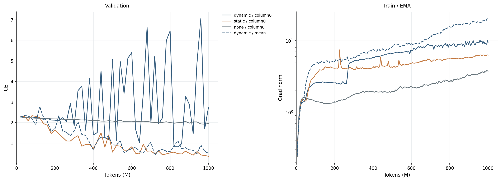

L2C4, около 1M параметров, clean, seed 42. Только завершённые запуски; полос неопределённости нет. Градиенты показаны до ограничения нормы до 1; большие нормы не означают пропуск optimizer update.

### Качество относительно измеренного времени обучения

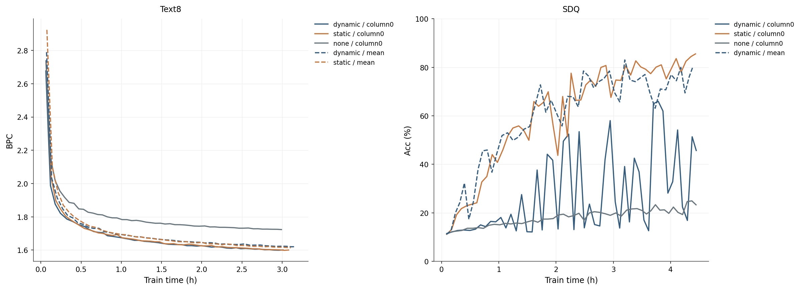

L2C4, около 1M параметров, clean, seed 42. Только завершённые запуски; полос неопределённости нет. Время без ночных пауз и evaluations, с Python/compile overhead. Два совместных GPU-процесса: не isolated latency benchmark.

### Фактически записанные время и память

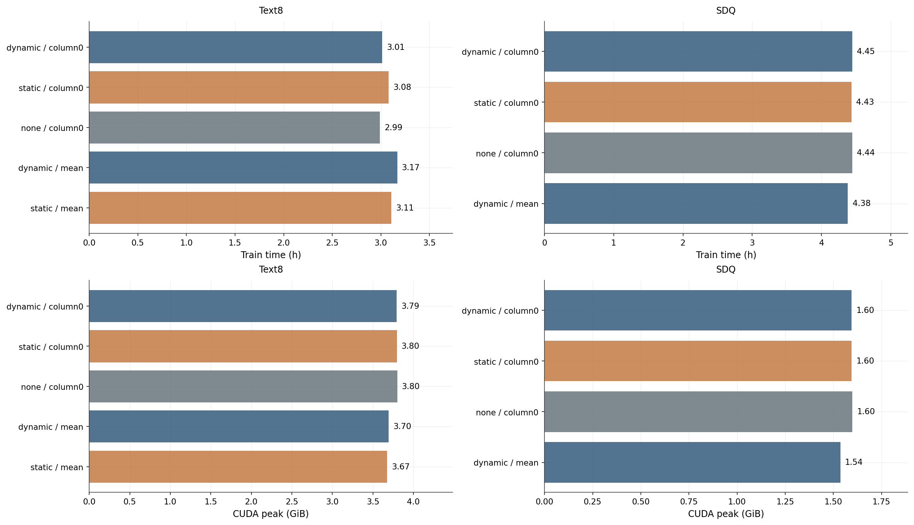

L2C4, около 1M параметров, clean, seed 42. Только завершённые запуски; полос неопределённости нет. CUDA peak относится к последнему процессу/сеансу: счётчик сбрасывается при resume. Ресурсы между разными задачами не уравнены.

### Доступные сравнения: маршруты и способ чтения памяти

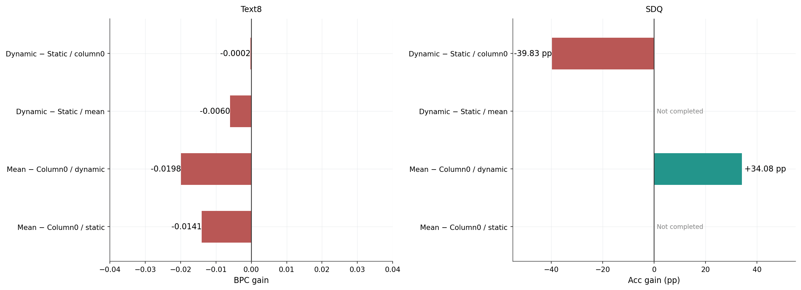

L2C4, около 1M параметров, clean, seed 42. Только завершённые запуски; полос неопределённости нет. Строки readout — отдельная диагностика. Главные контрасты с none_mean пока отсутствуют; сравнение с none_column0 их не заменяет.

<!-- checkpoint-diagnostics:start -->
## Диагностика памяти и участия колонок

В основной отчёт встроены 13 дополнительных графиков по девяти локальным checkpoints из среза за 12 октября 2026. Основные результаты и первые три графика обновлены за 13 октября, но эта диагностика остаётся на прежних девяти моделях. Новые головы и повреждения памяти оцениваются на отдельной диагностической выборке.

[Все 20 графиков одним PDF](all_figures_with_diagnostics.pdf).

Проанализированы 9 финальных checkpoints на полном бюджете около 1B токенов: 5 Text8 и 4 SDQ. Все модели — L2C4/H136, clean, seed 42. Незавершённые запуски не включены. Основные веса не менялись; дополнительные линейные головы обучены отдельно на CPU. Это диагностические результаты одного seed, а не новые полноценные обучения backbone.

### Что измерено

Linear CKA сравнивает геометрию состояний двух колонок на одних и тех же событиях: ||XᵀY||²_F / (||XᵀX||_F · ||YᵀY||_F), после центрирования признаков. Значения близки к 1 при сходных представлениях. CKA не доказывает независимость, специализацию или причинный обмен. Общий вход может сделать состояния похожими даже у независимых колонок. Для none_column0 колонки 1–3 не обучаются основной задачей; их CKA не следует трактовать как приобретённую специализацию.

Каждая новая голова — единственный линейный слой с bias. Проверены C0, C1, C2, C3, Mean и Concat. Последние четыре из шестнадцати probe-train потоков используются только для выбора: по их cross-entropy выбирается L2-штраф 0/0.01/0.1 на отклонение от начальных весов и checkpoint 0/50/100/…/400 updates. Остальные двенадцать потоков используются для градиентов. Mean/std признаков вычислены только по fitting-потокам. Основная validation не участвует в выборе. Optimizer AdamW, batch 512, LR=0.01, weight_decay=0.0001. Для полного ответа головы начинают с исходной trained head: concat сначала точно воспроизводит исходный column0 или mean readout; для декодирования сырого сохранённого значения используется нулевая инициализация. Сохранены эквивалентные веса в исходных координатах. Недостаток информации и недостаточное обучение probe не всегда различимы; плохой линейный probe не доказывает отсутствия нелинейно закодированной памяти.

Text8: 16 случайно выбранных непрерывных отрывков по 1024 шага отдельно из train и validation; первые 128 шагов каждого отрывка служат прогревом. Проверка содержит 14336 предсказаний, поэтому её BPC не заменяет основной full-validation BPC. Шесть новых голов обучаются предсказывать следующий символ из замороженных верхних состояний. Norm/share блоков concat-головы дополнены заменой каждого блока его train-средним при неизменных остальных блоках и весах головы.

SDQ: 16 потоков × 2048 шагов, T=500, p_store=0.1, p_query=0.25. Probe-train и validation используют разные генераторы и seed; первые 128 шагов исключены. Все модели получают одинаковые последовательности. Анализируется только query с известной предшествующей записью. Одна группа probes декодирует последнее сохранённое значение запрошенного ключа; вторая — полный ответ с накопителем distractors и счётчиками. Это разные цели. Native accuracy здесь тоже измерена только на таких queries и не равна общей held-out accuracy отчёта.

В отдельной SDQ-интервенции непосредственно перед query обнуляется состояние обоих слоёв одной колонки. Query-токен, правильный ответ, остальные состояния и исходная голова сохраняются; исходная траектория продолжается без этого изменения. Такая проверка учитывает доступ через коммуникацию, в отличие от простого удаления блока в новой выходной голове.

### Числа на диагностической выборке

| Задача | Условие | Queries/tokens | Native | Probe C0 | Probe Concat |
|---|---|---:|---:|---:|---:|
| sdq | dynamic_column0 | 6934 | 39.905% | 49.308% | 45.010% |
| sdq | static_column0 | 6934 | 84.569% | 84.569% | 84.569% |
| sdq | none_column0 | 6934 | 16.340% | 17.032% | 16.340% |
| sdq | dynamic_mean | 6934 | 80.661% | 77.358% | 80.747% |
| text8 | dynamic_column0 | 14336 | 1.555 | 1.555 | 1.555 |
| text8 | static_column0 | 14336 | 1.554 | 1.554 | 1.554 |
| text8 | none_column0 | 14336 | 1.667 | 1.667 | 1.667 |
| text8 | dynamic_mean | 14336 | 1.570 | 1.966 | 1.570 |
| text8 | static_mean | 14336 | 1.561 | 1.942 | 1.561 |

### Что уже видно в памяти

В SDQ dynamic_column0 верхние колонки 2 и 3 очень похожи: CKA=0.920. Из колонки 0 небольшой линейный probe декодирует полный ответ с accuracy 49.31%, из остальных — около 10%. Исходная голова на этой отдельной выборке известных записей даёт 39.90%. Значит, часть ухудшения можно уменьшить заменой декодера, но этот probe не восстанавливает результат static_column0. Подобие двух колонок — признак избыточности представлений на выбранных событиях, не доказательство общей причины провала.

При обнулении памяти каждой колонки SDQ dynamic_column0 ухудшается. Остальные колонки функционально используются, даже если полный ответ плохо читается из них отдельной линейной головой. Для dynamic_mean ответ доступен линейному чтению из каждой верхней колонки существенно лучше. Это разные организации информации; из этих наблюдений нельзя выбрать единственную причину различий без дополнительных controlled trainings.

В Text8 train-калибровка выбрала исходные веса concat-кандидата, update=0, у всех пяти моделей. Маленькая выборка не поддержала улучшение исходного декодера; обученные кандидаты переобучались. Поэтому нормы concat-блоков в этой серии в основном отражают исходную схему column0/mean. Их нельзя выдавать за обнаруженные уникальные вклады колонок. Для оценки функционального участия дополнительно выполнено удаление recurrent memory перед токеном при неизменном исходном декодере.

Probe сырого сохранённого SDQ-значения заметно слабее probe полного ответа. Это не доказывает отсутствия записи: SDQ требует ответа с дополнительной арифметикой, и память может кодировать преобразованное значение. Линейный decoder имеет ограниченную выразительность.

#### Участие колонок в исходном Text8-предсказании

| Условие | ΔBPC C0 | ΔBPC C1 | ΔBPC C2 | ΔBPC C3 |
|---|---:|---:|---:|---:|
| dynamic_column0 | +0.864 | +0.486 | +0.365 | +0.406 |
| static_column0 | +0.524 | +0.464 | +0.485 | +0.441 |
| none_column0 | +2.094 | +0.000 | +0.000 | +0.000 |
| dynamic_mean | +0.391 | +0.456 | +0.352 | +0.475 |
| static_mean | +0.382 | +0.369 | +0.376 | +0.391 |

Все числа — увеличение BPC при обнулении обоих слоёв указанной колонки перед текущим токеном. В communicating column0 моделях колонки 1–3 влияют на ответ косвенно через router, хотя выходная голова читает только колонку 0. У none_column0 удаление 1–3 не меняет ни одного logit: это проверено точным сравнением массивов. Падения при удалении разных колонок не складываются в проценты уникальных вкладов; повреждение памяти — сильная интервенция.


### Как это связано с низкой SDQ accuracy dynamic_column0

Хороший серверный Grid-GRU из отчёта H100 оценивался на Text8: 1.5966 ± 0.0050 BPC у L2C4 против локальных 1.6006 BPC. Это не демонстрация успешного SDQ в той серверной серии. Серверная Text8-конфигурация также использовала routing noise 0.05, communication penalty 0.05 и entropy bonus 0.005; локальные clean-controls их отключают.

На SDQ локальная training EMA dynamic_column0 доходит до 69.84%, а полная независимая accuracy последнего checkpoint — 45.71%. Лучшая записанная независимая accuracy — 66.01% около 840M; в поздних точках она резко колеблется. Dynamic_mean даёт 79.79%, static_column0 — 85.54%. Это указывает на чувствительность dynamic/single-column readout, но не устанавливает единственную причину. Новые probes и интервенции помогают отделить отсутствие доступной информации от ограничения исходного декодера. Они не доказывают, что выключение регуляризаторов вызвало падение: для этого нужен отдельный matched paper/clean contrast на SDQ и несколько seed.

### Графики

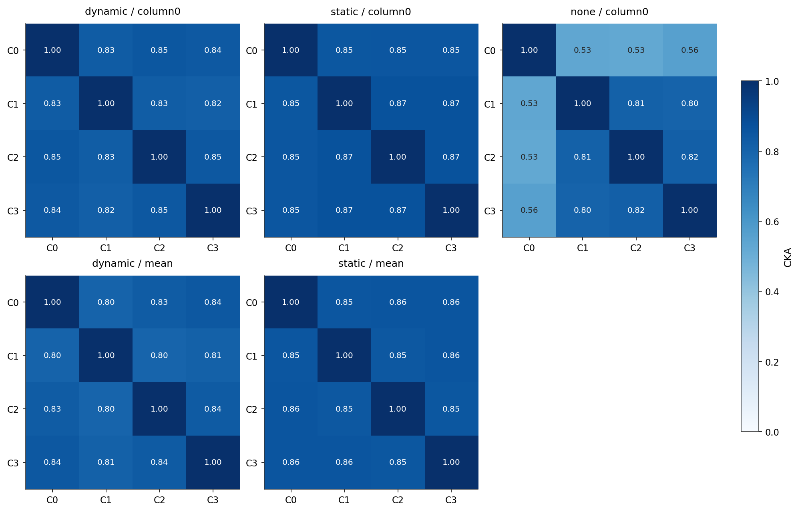

TEXT8, слой 1: linear CKA состояний на одинаковых проверочных событиях. Высокое значение означает сходство представлений; низкое не доказывает статистическую независимость.

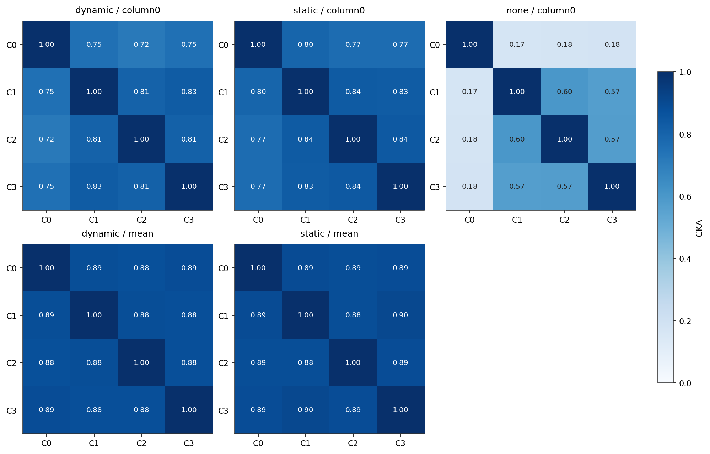

TEXT8, слой 2: linear CKA состояний на одинаковых проверочных событиях. Высокое значение означает сходство представлений; низкое не доказывает статистическую независимость.

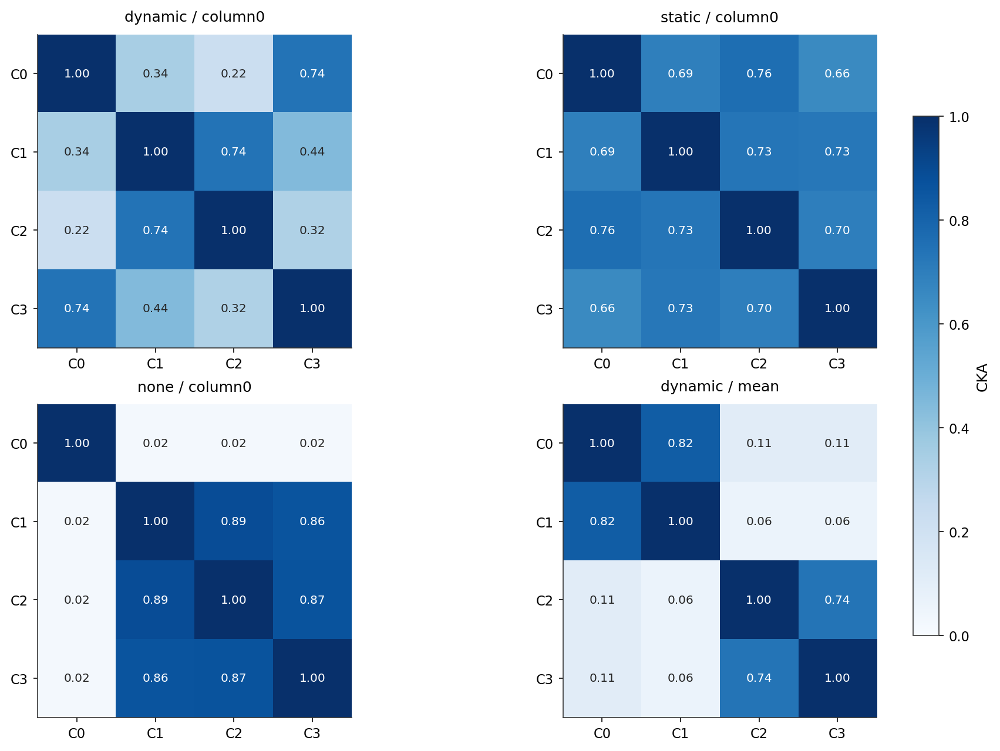

SDQ, слой 1: linear CKA состояний на одинаковых проверочных событиях. Высокое значение означает сходство представлений; низкое не доказывает статистическую независимость.

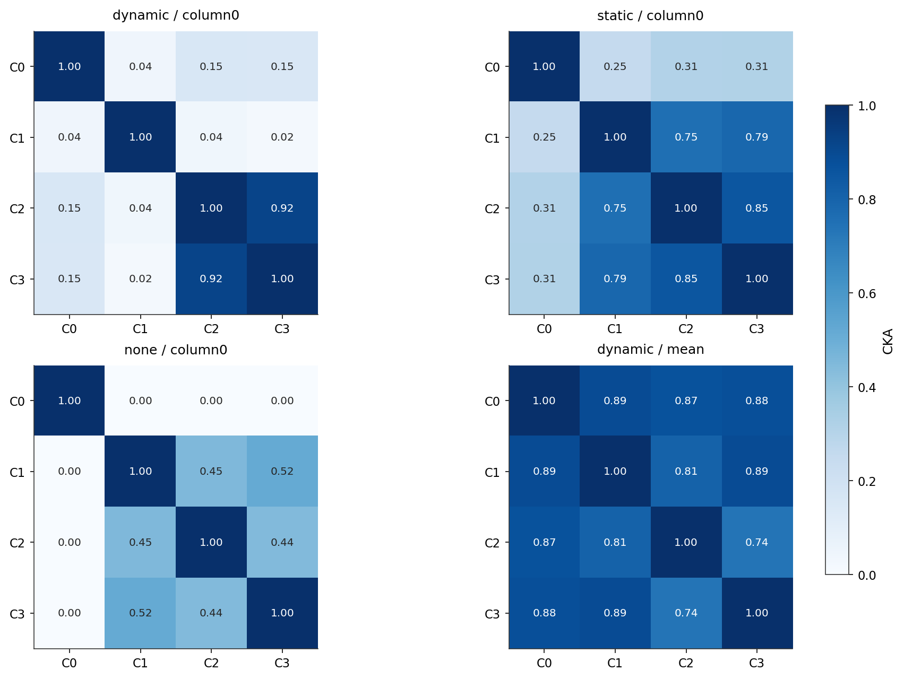

SDQ, слой 2: linear CKA состояний на одинаковых проверочных событиях. Высокое значение означает сходство представлений; низкое не доказывает статистическую независимость.

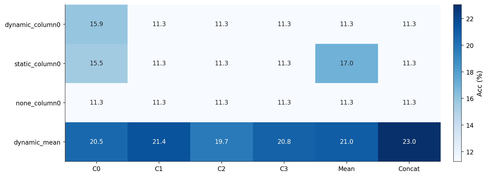

SDQ: accuracy линейного чтения последнего сохранённого значения запрошенного ключа. Включены только запросы с предшествующей записью.

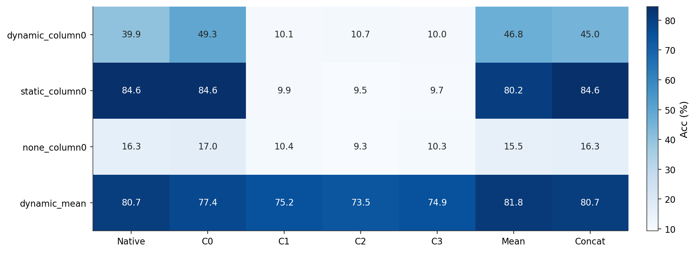

SDQ: accuracy линейного чтения полного ответа задачи, включая distractor accumulator и store/query counters. Native — исходная голова на той же выборке известных записей.

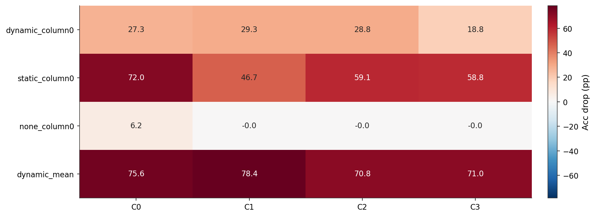

SDQ: перед текущим запросом обнулены оба слоя одной колонки; исходная голова сохранена. Положительное число — падение accuracy. Изменение не переносится на следующие события.

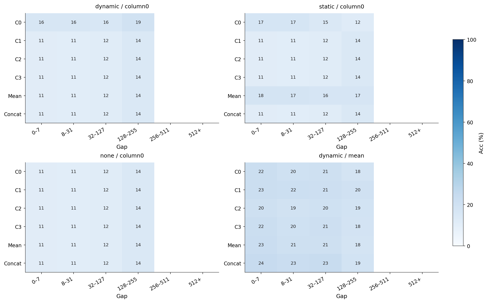

Чтение сохранённого значения на естественных SDQ gaps. В ячейках с менее чем 32 запросами число скрыто. Это интервалы естественных gaps, а не исходный fixed-gap benchmark.

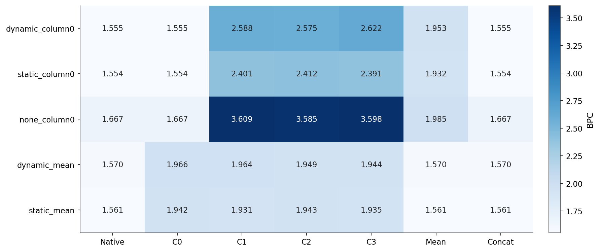

Text8: исходная голова и дополнительные линейные головы на замороженной памяти. Новые головы обучались на train-отрывках; таблица оценивает отдельные validation-отрывки.

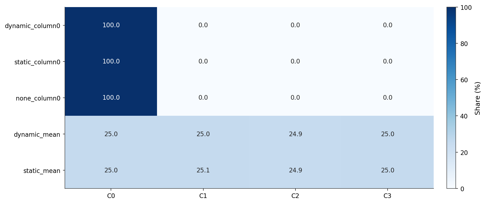

Text8: доли норм четырёх блоков дополнительной concat-головы после учёта масштаба признаков и удаления общего для классов сдвига. Это описание декодера, а не уникальная причинная доля колонки.

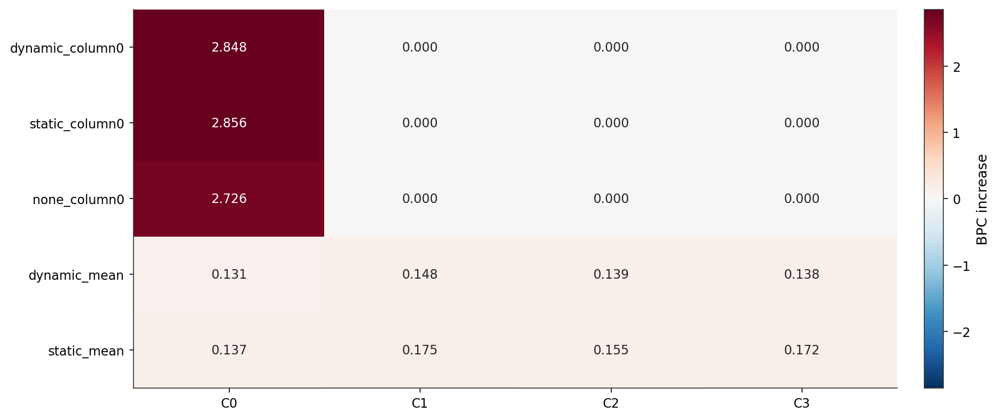

Text8: блок состояния заменён его средним на probe-train; concat-голова не переобучалась. Положительное число — ухудшение. Взаимозаменяемость коррелированных колонок остаётся ограничением.

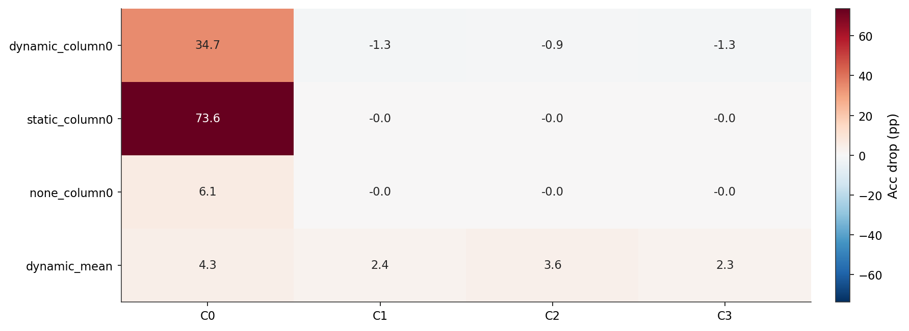

SDQ: замена блока верхнего состояния средним для дополнительной concat-головы полного ответа. Это доступность информации для нового декодера; исходная модель остаётся неизменной.

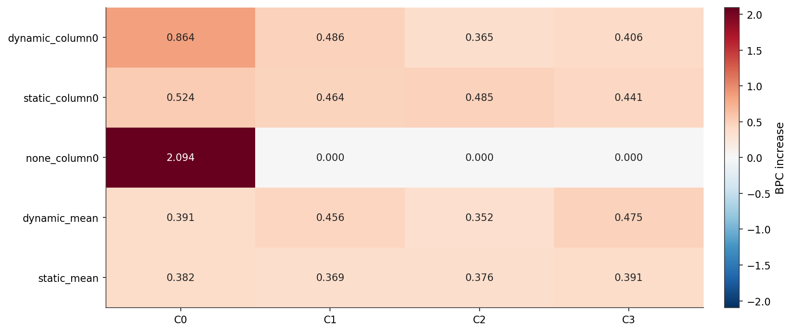

Text8: перед токеном обнуляются оба слоя одной колонки; исходные router и prediction head сохранены. Каждая из 3584 позиций сравнивается со своим неизменным состоянием. Интервенция не переносится на последующие токены.

### Воспроизведение и артефакты

Команда из корня репозитория: `OPENBLAS_NUM_THREADS=1 MKL_NUM_THREADS=1 OMP_NUM_THREADS=1 .venv/bin/python inference/select_communication_readouts.py --output /tmp/communication-diagnostics-reproduced`. Для повторного построения графиков без вычислений: `python -m inference.communication_diagnostics_report <output_dir>`. Manifest фиксирует входные checkpoints и их SHA256, настройки, источники реализации. В `runs/<task>/<condition>/` находятся features.npz, result.json и веса всех обученных probes. Исходные checkpoints только читаются. Все графики доступны в PNG/SVG/PDF, общий файл — [all_figures.pdf](../communication_diagnostics_2026-10-12_selected/all_figures.pdf).

Первый пилот с фиксированными 400 updates и нулевой инициализацией показал переобучение concat-головы на коротких Text8-отрывках; он сохранён в соседней папке communication_diagnostics_2026-10-12. Этот отчёт использует выбор на training-потоках и сохранённые признаки того же пилота. Протокол уточнялся после просмотра пилота: основная validation не является полностью нетронутым test. Уточнение метода не меняет CKA и интервенции с обнулением памяти, которые рассчитаны по исходным frozen checkpoints.

Нет междуобученческих confidence intervals: один seed. Блоки времени и отдельные запросы не заменяют независимые обучения. Линейная доступность информации, сходство состояний и вклад в исходное предсказание — разные свойства.

Дополнительная команда для Text8 memory lesions при воспроизведении: `OPENBLAS_NUM_THREADS=1 MKL_NUM_THREADS=1 OMP_NUM_THREADS=1 .venv/bin/python inference/text8_column_lesions.py --directory /tmp/communication-diagnostics-reproduced`, затем `python -m inference.communication_diagnostics_report /tmp/communication-diagnostics-reproduced`. Новый output directory необходим при изменении хэшей исходников; существующие результаты не перезаписываются другой реализацией probes. Данные и хэш реализации сохранены в text8_lesions.json, попарные logits и targets — в native_text_lesions.npz каждой модели.

<!-- checkpoint-diagnostics:end -->

## Ограничения простыми словами

Это один seed и одна форма L2C4. У графиков нет p-values и полос «надёжности» между обучениями: отдельные символы и queries не заменяют повторные обучения. Результаты относятся к `clean` и текущей новой оценке, поэтому их нельзя напрямую подставлять вместо исторических таблиц статьи.

Для SDQ online training accuracy сглажена EMA и измеряется на меняющейся по сложности задаче; held-out accuracy измеряется на фиксированной отдельной задаче. Их расхождение не равно обычному train/test gap. Fixed-gap probes — ещё одно распределение: в них нет перезаписи выбранного ключа.

Время измерялось при двух параллельных процессах на RTX 5060 Laptop. Оно исключает evaluations и ночные паузы, но включает Python/compile overhead; это наблюдение о наших сеансах, а не чистый benchmark архитектур. CUDA peak из summary относится только к последнему процессу/сеансу. Счётчик после resume начинается заново.

У validation-кривых восстановлены точные моменты оценки: расписание 20M, округление до полного optimizer update, затем финальный budget. Проверено соответствие каждой точки её записи в логе и совпадение последней оценки с summary. Дополнительное сглаживание и интерполяция не применялись.

## Данные и воспроизведение

Источники: локальные `runs/communication_1m/<task>/L2C4/clean/<condition>/seed42-data42/{config.yaml,metadata.json,metrics.jsonl,summary.json}` и финальные npz. Актуальные SHA256, числовые кривые и восстановленные evaluation steps первых трёх графиков записаны в [данных за 13 октября](../communication_2026-10-13/data.json). Источники дополнительных исторических графиков 4–7 сохранены в [data.json за 12 октября](data.json) и [CSV за 12 октября](endpoints.csv). [Все 20 графиков PDF](all_figures_with_diagnostics.pdf), [HTML-отчёт](index.html).

```bash
.venv/bin/python inference/communication_update_report.py
```

Команда перестраивает актуальные первые три графика в каталоге communication_2026-10-13/main_plots, на который ссылается этот Markdown-отчёт. Скрипт читает только локальные файлы и требует остановленной очереди. Он не запускает обучение, не возобновляет очередь и не меняет исходные логи.
