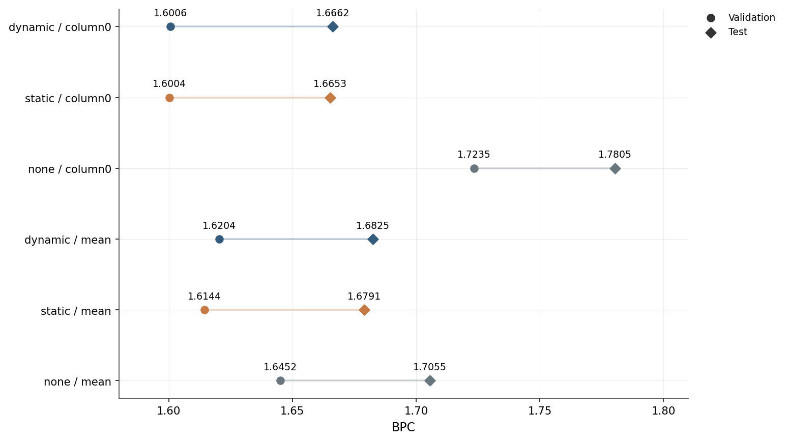
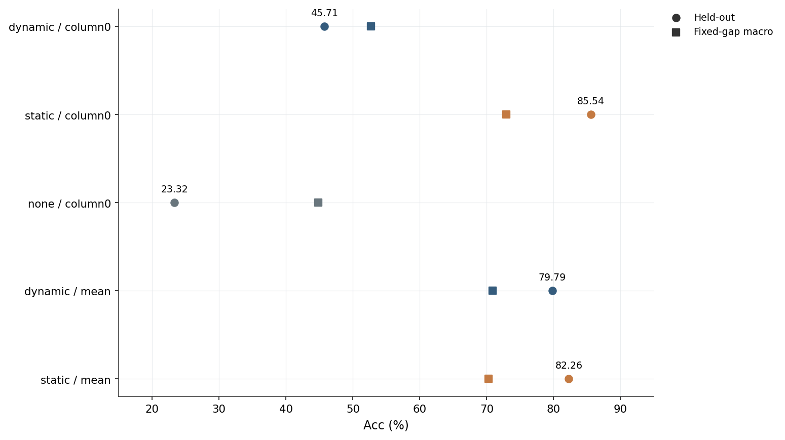
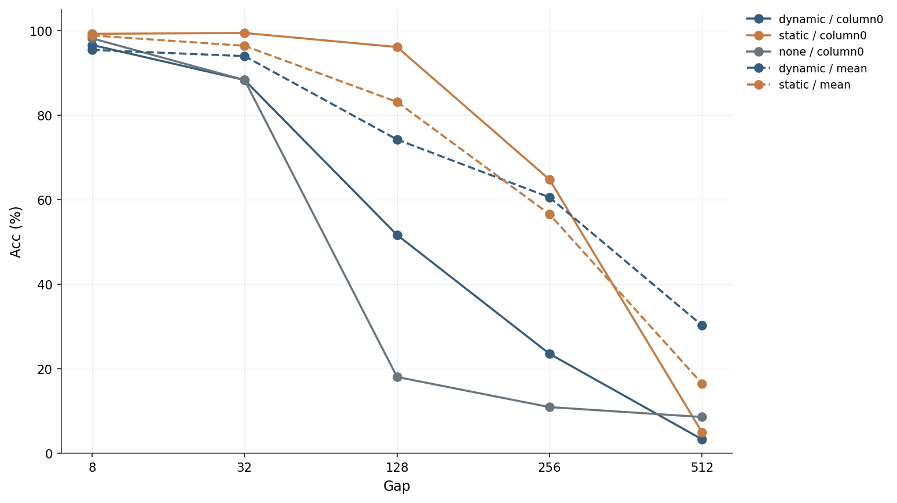
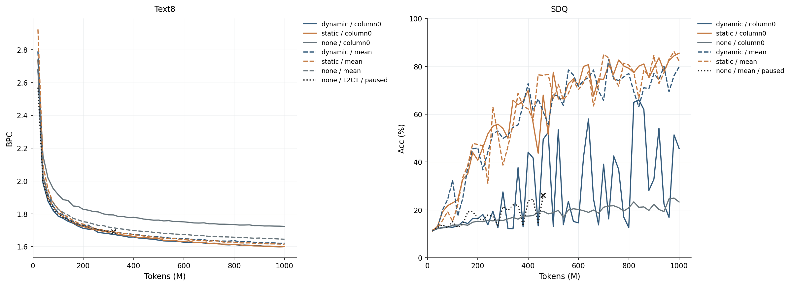
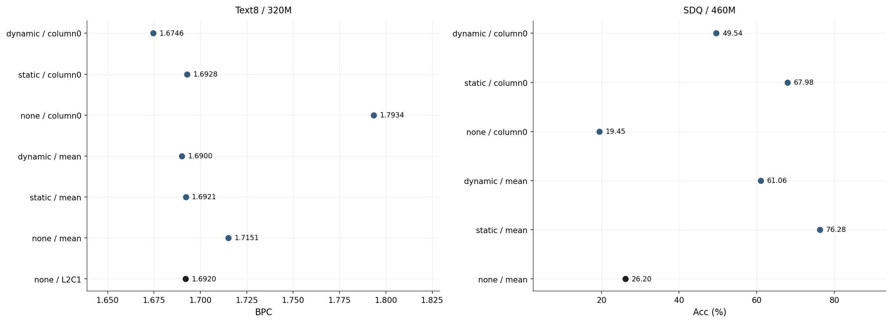

# Новые локальные результаты коммуникации MoSAIC

Срез: 13.10.2026 09:26 по Москве. Очередь остановлена по запросу пользователя: 11 завершённых запусков, 2 приостановленных, 3 ещё не начатых. Активных supervisor/worker процессов нет. Возобновление только вручную.

Новые завершённые результаты относительно отчёта за 12 октября: Text8 `none_mean` и SDQ `static_mean`. В основном сравнении L2C4/H136, clean, seed модели и данных 42; около 1M параметров, 1088 чисел recurrent state. Все завершённые условия внутри задачи получили одинаковый бюджет около 1B токенов и совпадающий протокол. Source/config/data/initialization matching проверен штатным summarizer.

**Все завершённые условия.** BPC ниже — лучше, accuracy выше — лучше. Выбраны последние checkpoints, а не лучшие точки траекторий.

| Условие | Text8 val BPC | Text8 test BPC | SDQ held-out Acc | SDQ fixed-gap macro |
|---|---:|---:|---:|---:|
| dynamic_column0 | 1.6006 | 1.6662 | 45.71% | 52.68% |
| static_column0 | 1.6004 | 1.6653 | 85.54% | 72.89% |
| none_column0 | 1.7235 | 1.7805 | 23.32% | 44.80% |
| dynamic_mean | 1.6204 | 1.6825 | 79.79% | 70.88% |
| static_mean | 1.6144 | 1.6791 | 82.26% | 70.27% |
| none_mean | 1.6452 | 1.7055 | не завершён | — |

**Что добавил Text8 none_mean.**

Без общения, но с чтением всех четырёх колонок, получено 1.6452 val BPC и 1.7055 test BPC. Это лучше none_column0 на 0.0783 val BPC: доступность остальных колонок действительно имеет значение в этом запуске. При этом none_mean хуже dynamic_mean на 0.0247 и static_mean на 0.0307 val BPC. Test сохраняет направление различий: соответственно +0.0230 и +0.0264 BPC.

Это более содержательный контроль коммуникации, чем none_column0: все 1088 state-чисел имеют путь к предсказанию, readout mean одинаков. Здесь преимущество communicating-моделей не объясняется только недоступностью трёх колонок в none_column0. Номинальное число параметров и dense matrix FLOPs совпадают; эффективные градиенты и общие вычисления не обязаны совпадать. Результат описательный, одного seed. Преимущество маршрутизации, зависящей от содержимого, над обучаемыми static-связями не установлено.

**Что добавил SDQ static_mean.**

Финальная held-out accuracy 82.26%: выше dynamic_mean на 2.47 процентного пункта, но ниже static_column0 на 3.28 пункта. Открыть readout всю верхнюю память через mean не оказалось универсальным улучшением: у dynamic это помогло, у static в этом seed ухудшило итоговую общую accuracy.

Средняя accuracy пяти fixed gaps у static_mean — 70.27%, у dynamic_mean — 70.88%, у static_column0 — 72.89%. На gap=512 static_mean даёт 16.50%, static_column0 4.98%, dynamic_mean 30.27%. Поэтому преимущество на обычной held-out задаче не означает лучшую память на каждом расстоянии. Mean может помогать сохранить доступ к длинным зависимостям, одновременно ухудшая короткие и средние; это интерпретация наблюдаемой картины, не установленный механизм.

**Приостановленные обучения: сохранён прогресс, результаты промежуточные.**

| Запуск | Checkpoint tokens | Последняя оценка при tokens | Метрика |
|---|---:|---:|---:|
| sdq / L2C4 / none_mean | 477,560,832 | 460,013,568 | 26.20% Acc |
| text8 / L2C1 / none_column0 | 333,250,560 | 320,012,288 | 1.6920 BPC |

Последняя validation у остановленного обучения относится к последнему выполненному evaluation, а не к весам в более позднем checkpoint остановки. Новая evaluation после остановки не выполнялась. Checkpoints прочитаны на CPU: проверены число токенов, fingerprint, source hashes и наличие состояния optimizer, recurrent memory, генератора, RNG и расписаний. Ничего не возобновлялось.

Одноколоночный Text8 имеет H228, 1 057 493 номинальных параметра и 456 активных state-чисел; L2C4 имеет H136, 1088 state-чисел, а none_column0 L2C4 использует для ответа только 272. Поэтому этот контроль устраняет бесполезные колонки, но не уравнивает размер памяти с L2C4. Его текущее качество не является итогом полного бюджета.

**Сравнение частичных запусков при одинаковом числе обучающих токенов.**

| Задача | Условие | Tokens evaluation | Метрика |
|---|---|---:|---:|
| text8 | dynamic / column0 | 320,012,288 | 1.6746 BPC |
| text8 | static / column0 | 320,012,288 | 1.6928 BPC |
| text8 | none / column0 | 320,012,288 | 1.7934 BPC |
| text8 | dynamic / mean | 320,012,288 | 1.6900 BPC |
| text8 | static / mean | 320,012,288 | 1.6921 BPC |
| text8 | none / mean | 320,012,288 | 1.7151 BPC |
| text8 | none / L2C1 | 320,012,288 | 1.6920 BPC |
| sdq | dynamic / column0 | 460,013,568 | 49.54% Acc |
| sdq | static / column0 | 460,013,568 | 67.98% Acc |
| sdq | none / column0 | 460,013,568 | 19.45% Acc |
| sdq | dynamic / mean | 460,013,568 | 61.06% Acc |
| sdq | static / mean | 460,013,568 | 76.28% Acc |
| sdq | none / mean | 460,013,568 | 26.20% Acc |

При 320M токенов широкая единственная колонка даёт 1.6920 BPC, а none_mean L2C4 — 1.7151. Одноколоночный вариант близок к static_mean (1.6921) и уступает dynamic_column0 (1.6746). Это показывает конкурентность широкой колонки на этой стадии, несмотря на меньший state. Число колонок само по себе не определяет качество; окончательного сравнения на полном бюджете ещё нет.

При 460M токенов SDQ none_mean даёт 26.20%, выше none_column0 (19.45%), но ниже dynamic_mean (61.06%) и static_mean (76.28%). Значит, промежуточное качество также нельзя объяснить только недоступностью трёх колонок в none_column0; отставание остаётся при чтении всей независимой памяти. Это наблюдение на промежуточном бюджете, не итоговый эффект.

Эта таблица сравнивает промежуточное качество при одинаковом бюджете и помогает читать ранние траектории. Она не заменяет результаты после 1B токенов. В частности, SDQ none_mean ещё не закончил curriculum: в момент остановки training T около 306, а validation с самого начала использует T=500.

**Что остаётся открытым для замечания ревью.**

На Text8 появились описательные данные в пользу межколоночного обмена при одинаковом номинальном state и доступе readout ко всем колонкам. На SDQ главный контраст dynamic_mean против none_mean пока не завершён. Dynamic не показал общего преимущества над обучаемым static. Один seed не даёт оценки устойчивости между обучениями; тестовая Text8-оценка — дополнительный сегмент того же обучения, не независимый seed. Конкатенационный none-readout и одноколоночный полный бюджет остаются незавершёнными.

Ещё не запускались: SDQ L2C1 none_column0, Text8 L2C4 none_concat и SDQ L2C4 none_concat. Они остаются в приостановленной очереди и автоматически не начнутся.

**Три основных графика, обновлённые по новым данным.** На кривых обучения показаны 11 завершённых и два остановленных запуска. Финальное качество и память по gap сравнивают только завершённые обучения с полным бюджетом. Подписи осей краткие, без общего заголовка и текстовых сносок внутри изображений.


L2C4, около 1M параметров, clean, seed 42. Чёрным пунктиром отмечены остановленные SDQ none_mean и Text8 L2C1; их последние validation предшествуют checkpoint остановки. SDQ train меняет сложность по curriculum; validation всегда использует T=500. X validation восстановлен по расписанию.


L2C4, около 1M параметров, clean, seed 42. Только завершённые запуски; полос неопределённости нет. Отсутствующие условия показаны серым; это не нулевой результат. Точки с разными маркерами измеряют разные критерии.


L2C4, около 1M параметров, clean, seed 42. Только завершённые запуски; полос неопределённости нет. Слева реальные queries с известным store; counts: 17130 / 41872 / 51513 / 6286 / 393 / 0. Справа 1024 примера на gap.

**Дополнительные сравнения.**



Все шесть условий завершены при одинаковом бюджете около 1B токенов. Ниже BPC — лучше.



Пять завершённых условий, одинаковый полный бюджет. Частичный none_mean в итоговый рейтинг не включён.



1024 примера на каждое расстояние. Выбранная запись не перезаписывается; это отдельное распределение, не обычные held-out queries.



Пунктирные чёрные кривые — остановленные обучения. Оценки привязаны к фактическому расписанию evaluation, а не к моменту отложенной записи в лог.



Text8 сравнивается при 320,012,288 токенах, SDQ при 460,013,568. L2C1 имеет другое число state и другую ширину; сравнение его архитектуры не является state-matched.

**CKA и чтение памяти.** Диагностики прежних девяти checkpoints сохранены в [отчёте с 13 графиками](../communication_diagnostics_2026-10-12_selected/report.md). Они не пересчитаны для двух новых завершённых моделей, поэтому их выводы не распространяются автоматически на новые checkpoints.

**Артефакты и воспроизведение.** [Все восемь графиков PDF](all_figures_with_main.pdf), [три основных графика PDF](main_plots/all_figures.pdf), [исходные данные и SHA256](data.json), [проверка остановки и целостности](validation.json). Основные протоколы: [конфиги и запуск](../../../knitwork/exps/communication/config/README.md).

```bash
.venv/bin/python inference/communication_update_report.py
```

Команда только читает локальные артефакты и строит отчёт. Она требует остановленной очереди; обучение и внешние tracker-запросы не запускает.
