# H100: что проверили и что получилось

Это **отдельный отчёт о серверной серии**. Данные заново прочитаны 12 октября 2026 с `aicenter3` и из Comet; сами найденные запуски проводились 1–4 октября. Локальная серия `dynamic/static/none` на RTX 5060 сюда не включена. Обучения на сервере при подготовке отчёта не запускались и не останавливались.

## Что найдено и чему можно доверять

В очереди зарегистрировано **117 заданий**. По логам/return codes: 82 имеют признак нормального завершения, 11 не завершены нормально или завершились с ошибкой, 24 не запускались. **В папке running осталось 8 старых записей, но соответствующие наши training processes не живы.** По одному имени папки нельзя судить о текущем обучении.

Свежий Comet snapshot содержит **87 experiment IDs** этой серверной серии, с кривыми/параметрами; ошибок чтения у них нет. Ещё 9 старых IDs ранних остановленных MQAR-попыток не найдены в доступных списках Comet и не используются для сравнения качества. Retries и зарегистрированные задания — не одно и то же число.

На ноде сейчас все семь GPU — H100 80GB HBM3. Для включения эксперимента использована связь job → stdout Comet URL → experiment id. Источники и их hashes сохранены. Никакие метрики чужих текущих процессов не использовались.

## Простая постановка

**Text8:** модель читает текст по символам и угадывает следующий символ. BPC — ошибка, меньше лучше. Основные новые модели имеют примерно 1M полных параметров, train/val/test split 90M/5M/5M, бюджет около 1B токенов, 512 потоков и отрезки обучения длиной 64. В основной mid-серии есть seed 42 и 1337, у ряда GRU/Grid форм ещё 31337. Размер памяти и вычисления между разными семействами не уравнены.

**MQAR:** модель получает несколько пар ключ—значение и затем должна вспомнить правильное значение по ключу. Есть пять уровней сложности с разной длиной и числом пар. В этой серии около 1M параметров recurrent core, но **около 4M полных параметров** из-за большого vocabulary/embedding. Бюджет новых запусков — 8 эпох, batch 32, полный градиент через последовательность. Старые прерванные попытки и slot-crashes не являются результатами качества.

**RL:** модель выбирает действия в средах, где нужно помнить прошлые наблюдения. В `RepeatPreviousHard` вспоминается прошлый элемент; в `AutoencodeEasy` надо воспроизвести показанную последовательность. Return — награда за эпизод, больше лучше. Бюджет каждого запуска около 8,39M vector slots, один seed. Эти slots нельзя автоматически приравнивать к числу полезных переходов среды.

## Что означает каждый набор вариантов

| Проверка | Простое объяснение | Что остаётся ограничением |
|---|---|---|
| Основные baselines | GRU, Mamba, HGRN2, DeltaNet, mLSTM, RIMs, BRIMs, Grid-GRU, Grid-LRU и Transformer получают сопоставимый бюджет данных | Наши реализации и настройки; это не лучшие опубликованные версии каждого семейства |
| L1C8 / L2C4 / L2C8 / L3C4 | Меняем число слоёв и колонок памяти | Вместе меняются state и вычисления |
| Top-1 / Top-2 | Колонке разрешён один или два выбранных источника вместо всех | Качество не доказывает реальную экономию FLOPs |
| Self-heavy | Больше опоры на свою память | Отдельная Grid-LRU серия |
| Star | Остальные колонки обмениваются через центральную | Фиксированная геометрия маршрутов |
| Star-ring | К центральным связям добавлено кольцо соседей | Меняется доступность источников |
| Clockwork | Некоторые колонки обновляются реже | Меняется частота recurrent updates |
| Block | Входные и выходные проекции LRU разбиты на две группы каналов, между слоями каналы переставляются | Связи между колонками остаются плотными; меняются проекции и число параметров |
| Entmax | Обучаемое более разреженное распределение весов связи | Нет отдельного speedup benchmark |
| Dynamic hub | Центральная колонка выбирает периферию по текущему контексту | Это старый LRU-router, не локальный GRU communication control |
| Write gate | Центр решает, насколько обновлять каждую периферийную память | Добавляются параметры; сохранение памяти не равно sparse execution |
| Query read | Центр читает из памяти только узкую часть, нужную для текущего запроса | Дополнительные read projections |
| Associative | Одна LRU-колонка заменена матрицей, которая записывает и извлекает пары | Весов меньше, state больше; параметры не строго matched |
| Rotations | Небольшие обучаемые повороты напрямую перемешивают состояния | Сохранение нормы поворота не гарантирует стабильность всей модели |
| Two reads | После обычного шага центр ещё раз читает свежие сообщения | Те же веса, но больше вычислений |
| Rollout 64 / 512 | Градиент проходит через короткий или длинный кусок истории | При одинаковом tokens/update streams меняются 512→64 |
| No noise | Убираем шум в маршрутах | Короткий пилот 67M, один seed |
| No communication penalty | Убираем дополнительный штраф за обмен | **Сам обмен остаётся** |
| No entropy bonus | Убираем дополнительную награду за разнообразие маршрутов | Сам dynamic-router остаётся |
| No aux | Убираем все три добавки к loss | **Это не режим none без межколоночного обмена** |

Названия control/static/dynamic/none между разными сериями нельзя приравнивать без проверки кода. Реализация локальных `dynamic`, `static`, `none` подробно описана в [отдельном отчёте](../communication_2026-10-12/report.md). В серверной абляции регуляризаторов `none` означает только отсутствие auxiliary noise/loss/bonus.

## Результаты Text8

Основная таблица сравнивает **точно одинаковый шаг 980,037,632 токенов** по continuous validation. Среднее ± SD считается по отдельным seed. Это не доверительный интервал и не формальный тест значимости.

| Модель | Seed | BPC ↓ |
|---|---:|---:|
| Mamba | 2 | 1.5651 ± 0.0012 |
| Grid-GRU L3C4 | 3 | 1.5916 ± 0.0012 |
| Grid-GRU L2C4 | 3 | 1.5966 ± 0.0050 |
| Grid-GRU L2C8 | 2 | 1.6082 ± 0.0019 |
| GRU L3 | 2 | 1.6205 ± 0.0076 |
| GRU L2 | 3 | 1.6368 ± 0.0018 |
| Grid-GRU L1C8 | 2 | 1.6369 ± 0.0016 |
| Grid-LRU L3C4 | 3 | 1.6690 ± 0.0052 |
| HGRN2 | 2 | 1.6695 ± 0.0005 |
| GRU L1 | 2 | 1.6807 ± 0.0003 |
| Grid-LRU L2C8 | 2 | 1.7156 ± 0.0047 |
| mLSTM | 2 | 1.7163 ± 0.0039 |
| Grid-LRU L1C8 | 2 | 1.7473 ± 0.0005 |
| DeltaNet | 2 | 1.7849 ± 0.0005 |
| RIMs | 2 | 1.8744 ± 0.0977 |
| BRIMs | 2 | 1.8968 ± 0.0318 |

Grid-LRU L2C4 оставлен отдельно со всеми 3 seed: 1.6750 ± 0.0032 BPC в собственной общей точке 960,036,864. У одного seed отсутствует метрика основной поздней точки; seed не удалён ради совпадения budget.

Общая точка абсолютно всех recurrent/baseline групп в свежем snapshot только 420,016,128: после неё пропуски у GRU-L2 и Grid-LRU-L2C4 чередуются. Поэтому основной поздний срез выбирается только по наличию точек у всех seed группы, без просмотра их качества. Ранний общий срез сохранён отдельно в analysis.json и на дополнительном графике.

Transformer показан отдельно: **1.6396 ± 0.0098 BPC**, 2 seed, собственная общая точка 982,646,784. Эта точка не совпадает с основной таблицей; интерполяция не применялась.

В основном позднем срезе Mamba даёт самый низкий средний BPC; далее идут Grid-GRU L3C4 и L2C4. Grid-LRU в целом хуже соответствующего Grid-GRU. Большая глубина сама по себе не улучшает результат одинаково у всех семейств. Точный порядок виден в таблице и на графиках; он относится к этим настройкам и seed.

### Изменения памяти и маршрутов

| Серия | Вариант | Общие токены | BPC ↓ |
|---|---|---:|---:|
| topk | dense | 980,037,632 | 1.5921 |
| topk | top1 | 980,037,632 | 1.8869 |
| topk | top2 | 980,037,632 | 1.6353 |
| sparse | control | 240,009,216 | 1.8779 |
| sparse | self_heavy | 240,009,216 | 1.8631 |
| sparse | star | 240,009,216 | 1.8724 |
| sparse | star_ring | 240,009,216 | 1.8897 |
| sparse | clockwork | 240,009,216 | 1.9282 |
| sparse | block | 240,009,216 | 1.9487 |
| sparse | entmax | 240,009,216 | 1.8806 |
| sparse | dynamic_hub | 240,009,216 | 1.8153 |
| architecture | control | 980,037,632 | 1.6687 |
| architecture | write_gate | 980,037,632 | 1.6675 |
| architecture | query_read | 980,037,632 | 1.6872 |
| architecture | associative | 980,037,632 | 1.6938 |
| architecture | rotations | 980,037,632 | 1.6663 |
| architecture | two_reads | 980,037,632 | 1.6530 |
| ablation | full | 50,331,648 | 1.9260 |
| ablation | no_aux | 50,331,648 | 1.9282 |
| ablation | no_noise | 50,331,648 | 1.9243 |
| ablation | no_comm_penalty | 50,331,648 | 1.9220 |
| ablation | no_entropy_bonus | 50,331,648 | 1.9224 |

Варианты с дополнительной памятью не дают общего улучшения на Text8. Результат отдельного варианта надо сравнивать с его собственным control, а не с другим LRU baseline. Короткие регуляризаторные ablations отвечают только на ранний участок обучения.

### Пилот длины обучения

| Модель | r64 BPC | r512 BPC | Разница r512−r64 |
|---|---:|---:|---:|
| Grid-GRU | 1.9260 | 1.9464 | +0.0204 |
| Grid-LRU | 2.4867 | 2.4870 | +0.0004 |
| GRU | 1.9826 | 2.0034 | +0.0208 |
| LRU | 2.1575 | 2.1552 | -0.0022 |

Каждому pilot дан budget 67 108 864 токена, 2048 updates. В свежих Comet-кривых финальные оценки отсутствуют: последняя точно общая точка сравнительной таблицы — 50 331 648 токенов. Финальные округлённые BPC из stdout приведены отдельно ниже. Более длинный backprop помогает не всем моделям. Это пилот для выбора следующих проверок, а не финальная оценка после 1B.

## Финальные округлённые pilot-результаты из stdout

| Pilot | Вариант | BPC на 67.11M (округлено в логе) |
|---|---|---:|
| rollout | Grid-GRU r64 | 1.862 |
| rollout | Grid-GRU r512 | 1.883 |
| rollout | Grid-LRU r64 | 2.300 |
| rollout | Grid-LRU r512 | 2.317 |
| rollout | GRU r64 | 1.912 |
| rollout | GRU r512 | 1.928 |
| rollout | LRU r64 | 2.068 |
| rollout | LRU r512 | 2.067 |
| auxiliary ablation | full | 1.862 |
| auxiliary ablation | no_aux | 1.866 |
| auxiliary ablation | no_noise | 1.868 |
| auxiliary ablation | no_comm_penalty | 1.863 |
| auxiliary ablation | no_entropy_bonus | 1.861 |

Эти цифры округлены до трёх знаков исходным stdout. Они не подменяют Comet-точки большей точности; малые различия ниже разрешения округления не интерпретируются.

**Что показывает rollout pilot.** На финальных 67.11M токенов r512 хуже r64 у Grid-GRU примерно на 0.021 BPC, у Grid-LRU — на 0.017, у GRU — на 0.016. У LRU разница около −0.001 BPC, практически на уровне округления. Поэтому здесь не видно общего выигрыша от перехода к длинному backpropagation. Это совместное изменение длины rollout 64→512 и числа потоков 512→64 при одинаковых 32,768 tokens/update, а не изолированная проверка длины градиента. Частота случайных resets по токенам в конфигурациях компенсирована.

**Что показывает auxiliary pilot.** Все пять вариантов заканчивают в узком диапазоне 1.861–1.868 BPC. Относительно full удаление entropy bonus даёт примерно −0.001, communication penalty — +0.001, всех добавок — +0.004, routing noise — +0.006 BPC. Значения ±0.001 нельзя использовать для уверенного ранжирования по округлённому логу. На точной Comet-точке 50.33M no_noise и no_comm_penalty ещё немного лучше full; к финалу знак их различий меняется. Значит, порядок чувствителен к моменту оценки.

**Граница вывода.** Каждый вариант представлен одним seed и коротким бюджетом 67M вместо 1B. Эти результаты не доказывают ненужность регуляризаторов и не объясняют сами по себе низкую SDQ accuracy локального dynamic_column0: pilot относится к Text8. Приоритетное наблюдение здесь — отсутствие общего раннего выигрыша r512; влияние отдельных auxiliary additions требует полного бюджета и повторных seed.

## Результаты MQAR

Все шесть вариантов сравниваются в точке **173,598,720 токенов**, доступной у каждого. Отдельно показана последняя доступная точка каждого запуска: её нельзя использовать как одинаковый budget для ранжирования.

| Вариант | Accuracy на общей точке | Macro по пяти bins | Последняя доступная Acc | Токены последней точки |
|---|---:|---:|---:|---:|
| control | 2.70% | 8.57% | 2.69% | 190,664,704 |
| write_gate | 2.36% | 8.12% | 2.32% | 190,664,704 |
| query_read | 0.02% | 0.03% | 0.02% | 173,598,720 |
| associative | 2.06% | 7.44% | 1.52% | 182,636,544 |
| rotations | 1.74% | 6.56% | 1.70% | 190,664,704 |
| two_reads | 1.74% | 6.52% | 1.80% | 186,650,624 |

У всех моделей общая accuracy остаётся низкой. Короткие и лёгкие примеры заметно проще длинных и нагруженных памятью. Большая training accuracy не означает такую же held-out accuracy; query-weighting усиливает вес сложных bins.

В query_read и associative видны большие всплески gradients, а query_read пропускает часть updates. Лучший ранний момент и поздний результат могут сильно различаться. Поэтому здесь показаны полные траектории, а не только лучший score. Comet не содержит все финальные оценки, которые есть в stdout. Серверные status.json/metrics.json для этих старых MQAR-запусков в проверенном каталоге runs не найдены. Свежие Comet кривые и stdout доступны; полного подтверждения финальной оценки каждого варианта из run artifacts здесь нет.

## Результаты RL

Для основного сравнения используем среднее последних четырёх **общих** eval steps. Это четыре точки одного обучения, а не четыре независимых запуска. Отдельно показываем лучший записанный момент, чтобы видеть возможное ухудшение.

| Среда | Модель | Последние 4 общие оценки | Лучший записанный Return |
|---|---|---:|---:|
| RepeatPreviousHard | GRU | -0.5161 | -0.4857 |
| RepeatPreviousHard | LRU | -0.3809 | -0.3404 |
| RepeatPreviousHard | Grid-GRU | -0.4942 | -0.4796 |
| RepeatPreviousHard | Grid-LRU | -0.4973 | -0.4823 |
| RepeatPreviousHard | dynamic_hub | -0.4963 | -0.4871 |
| RepeatPreviousHard | two_reads | -0.4927 | -0.4817 |
| AutoencodeEasy | GRU | -0.4964 | -0.4736 |
| AutoencodeEasy | LRU | -0.4663 | -0.4002 |
| AutoencodeEasy | dynamic_hub | -0.5072 | -0.4928 |
| AutoencodeEasy | two_reads | -0.5111 | -0.4952 |

Эта короткая RL-серия не показывает устойчивого общего преимущества модульных моделей. Отдельный лучший момент не означает, что улучшение сохраняется к концу обучения. По одному seed нельзя делать вывод о надёжности RL обучения.

## Графики

### Text8: сравнение моделей на 980.04M токенов

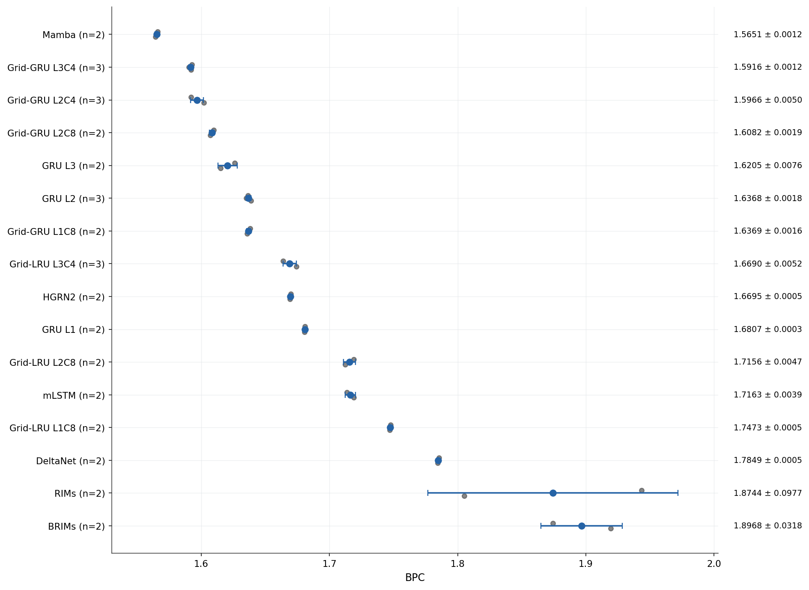

Точки — отдельные seed; центр и whiskers — среднее ± SD между seed, не CI. Все эти модели около 1M полных весов. Transformer приведён отдельно из-за другого набора точек оценки.

### Дополнительный общий срез всех моделей

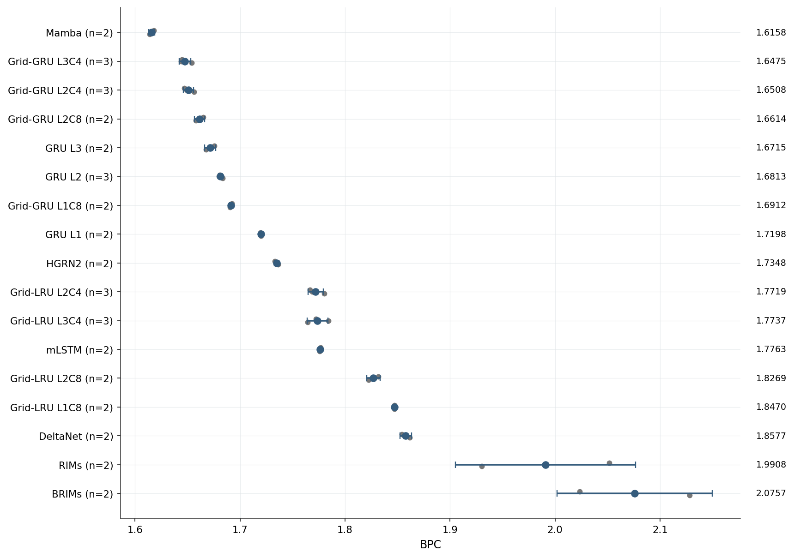

Все 17 non-Transformer групп, без удаления seed: 420,016,128 токенов. Это ранний срез. Основной поздний рейтинг приведён отдельно.

### Text8: как обучались основные сравниваемые модели

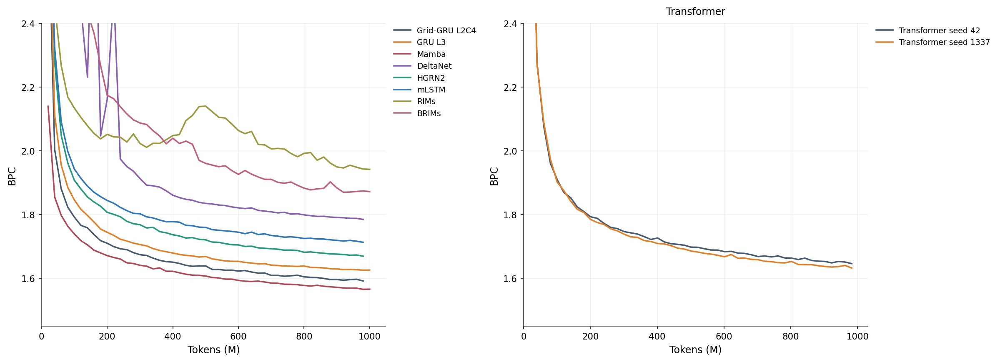

Кривые continuous validation. Область BPC выше 2.4 в начале выходит за ось; полные значения сохранены в исходном snapshot. Transformer нельзя подставлять в общую точку без отдельного правила согласования.

### Text8: глубина и число колонок

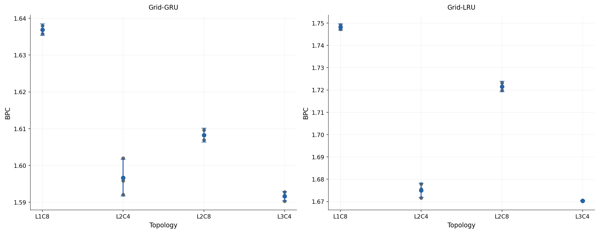

Общий шаг 980037632; каждая точка seed видна. Размер state и вычисления различаются между формами, несмотря на близкое число весов.

### Text8: dense, top-1 и top-2 обмен

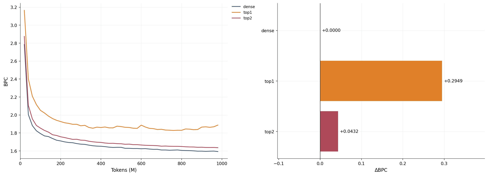

Один seed 42. Top-k меняет допустимые источники сообщения; эти запуски не измеряют выигрыш sparse execution или полной стоимости FLOPs.

### Grid-LRU: разные схемы обмена между колонками

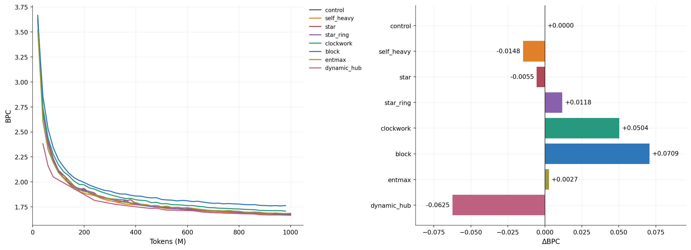

Сравнение с отдельным LRU control, не с текущей локальной clean-серией. Разные схемы распределяют сообщения и частоту обновлений; скорость экономии вычислений отдельно не доказана.

### Grid-LRU: пять изменений записи и чтения памяти

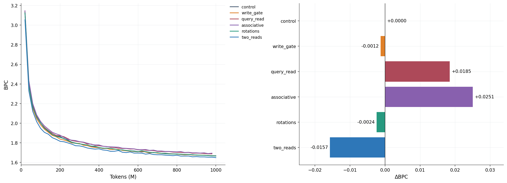

Ширина сохранена, но параметры, state и вычисления не строго равны. Two-reads добавляет вычисления; associative заменяет LRU-колонку матрицей памяти.

### Короткий пилот: обучение на отрезках 64 или 512 шагов

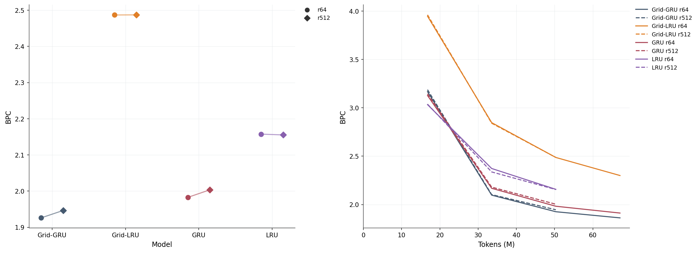

Каждому pilot дан бюджет 67 108 864 токенов, 2048 updates; точки слева сравниваются на общей Comet-точке 50 331 648. Tokens/update одинаковы; streams меняются 512→64, поэтому это не изолированный эффект длины backprop. Линии — один seed.

### Короткая ablation: шум и вспомогательные штрафы

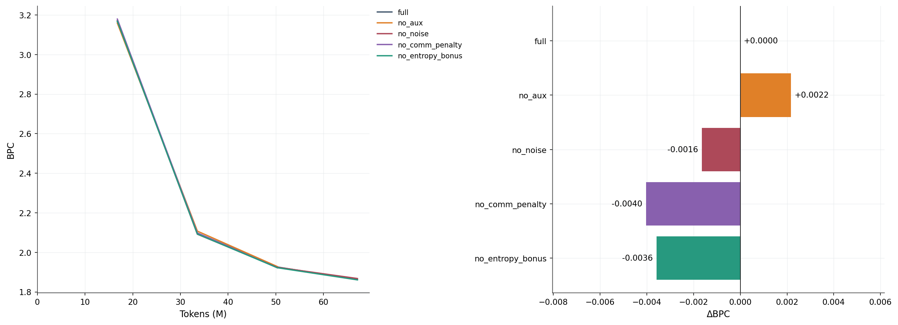

no_comm_penalty отключает штраф, а no_aux — все три добавки. Сам обмен между колонками остаётся во всех этих H100 вариантах. Это не локальный routing=none.

### MQAR: качество поиска запомненных пар

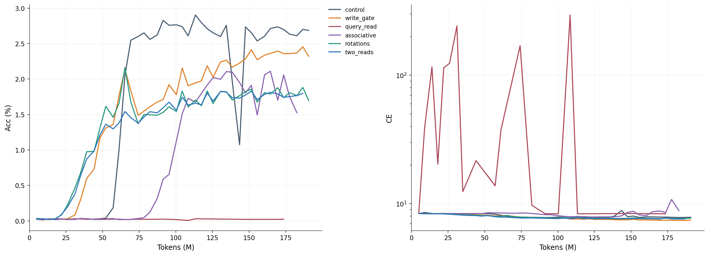

MQAR — отдельная задача, V8192 и около 4M полных весов, из них около 1M core. CE на логарифмической шкале. Разные конец/полнота Comet-логов показаны в таблице отдельно; stdout может содержать более поздние округлённые оценки.

### MQAR: разные уровни сложности, 173.60M токенов

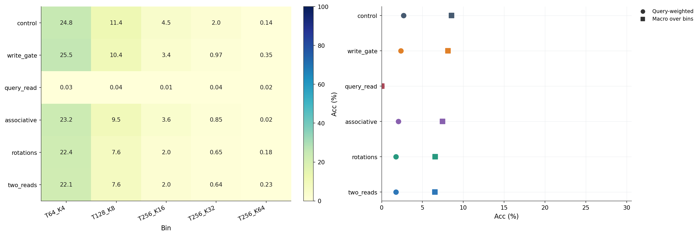

T — длина последовательности, K — число пар. В общей accuracy длинные примеры имеют больше queries. Macro сначала одинаково взвешивает пять bins. Это разные критерии.

### MQAR: устойчивость обучения

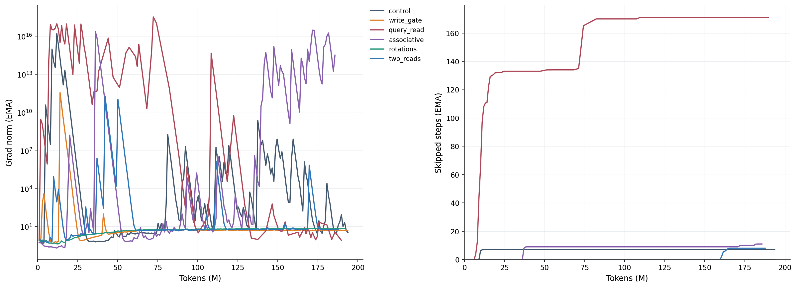

Это сглаженные training diagnostics, а не точный cumulative counter или повторные обучения. Большие private-state/gradient колебания — наблюдение, не доказанный диагноз причины.

### RL: оценка поведения по мере обучения

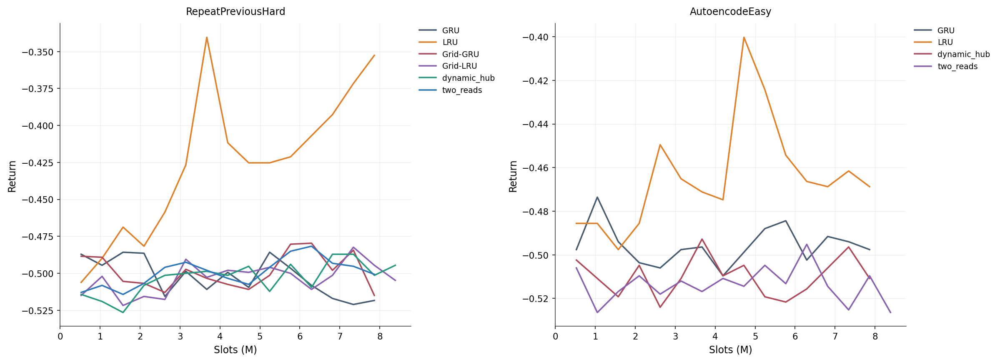

Return — награда за эпизод, больше лучше. X считает vector slots, не только valid environment transitions. Среда и протокол отличаются от Text8/MQAR.

### RL: лучший момент и результат к концу обучения

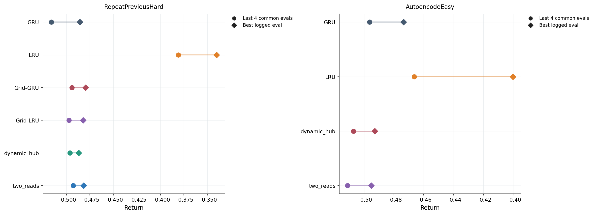

Последние четыре оценки — четыре точки одного обучения, не четыре seed. Best logged evaluation приведена как диагностика, не как выбранный основной результат.

## Как получены числа

Каждая кривая прочитана из свежего Comet snapshot по ID из H100 stdout. Если у одного шага несколько значений, используется запись с последним timestamp. Нечисловые/нефинитные точки не рисуются. Для сравнения вариантов берётся последний точно общий шаг; значения между точками не интерполируются. BPC вычисляется как cross-entropy / ln(2).

Text8 основной серии использует continuous validation для quality curves; checkpoint selector исторически использовал reset-1024 validation. В этом отчёте нет выбора вариантов по test. Pilot и full-budget curves не объединяются в один рейтинг; MQAR и RL не приравниваются к Text8.

Много seed есть только у части Text8 baselines. Остальные механизмы/пилоты/RL в основном представлены одним seed. Error bars в baseline-графиках — SD между seed. Соседние checkpoints не считаются повторными обучениями.

Скорость H100 из этих совместных запусков не является изолированным hardware benchmark: одновременно работали другие процессы, а SDK мог задерживать upload. Поэтому в основные графики качества не включены шумные Comet perf/fps и durationMillis как «чистое время модели».

## Источники и воспроизведение

[Снимок серверной очереди и stdout](server_snapshot.json), [свежие метрики Comet](comet_snapshot.json), [Результат поиска MQAR run artifacts: пустой](mqar_artifacts.json), [числовой анализ](analysis.json), [все задания CSV](inventory.csv), [baselines CSV](baselines.csv), [PDF всех графиков](all_figures.pdf), [галерея](index.html). SHA256 исходных снимков сохранены в analysis.json.

```bash
# Повторить графики без сети и без обучения:
.venv/bin/python inference/h100_report.py

# Только при необходимости обновить read-only Comet snapshot:
.venv/bin/python inference/fetch_h100_report.py
```

Незавершённые/упавшие slot-проверки и ранние остановленные MQAR-запуски остаются в inventory, но не получают придуманных значений качества. Нет claims о state of the art или полном закрытии замечаний статьи: это отчёт о доступных проведённых проверках.
