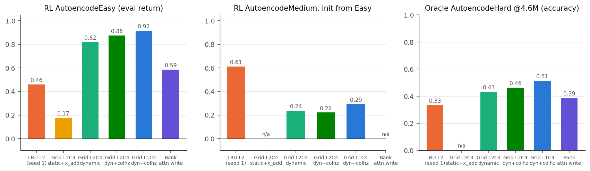
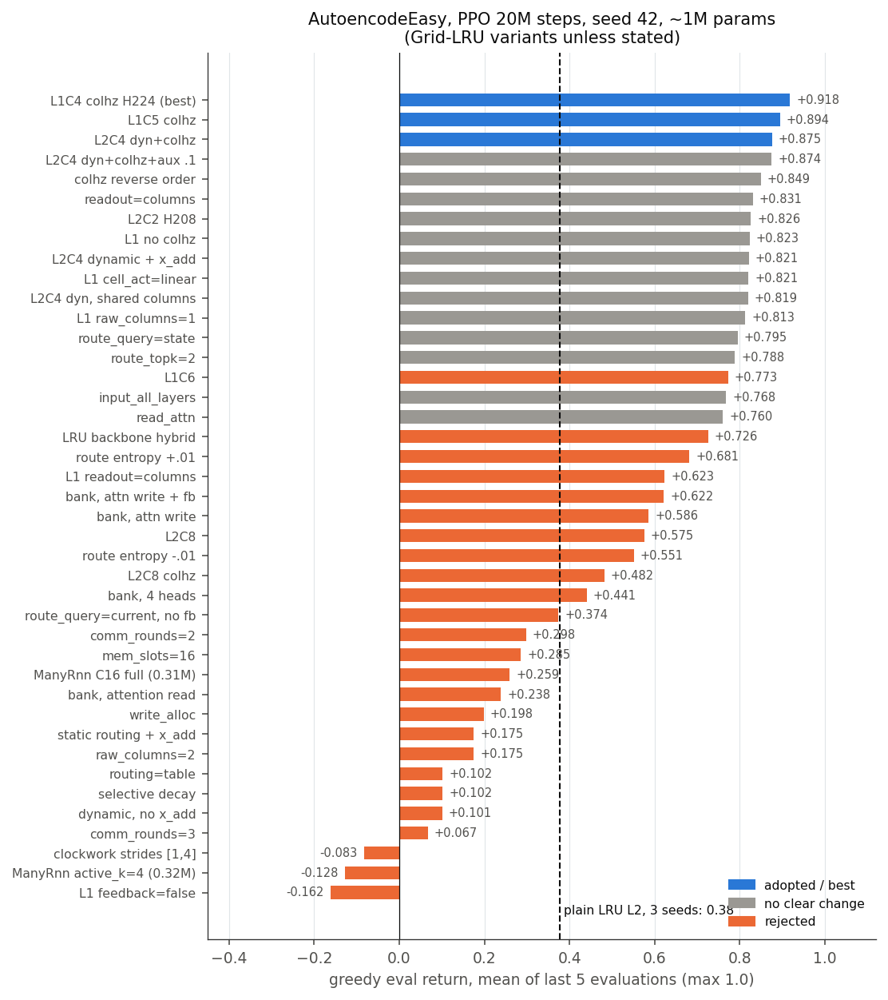
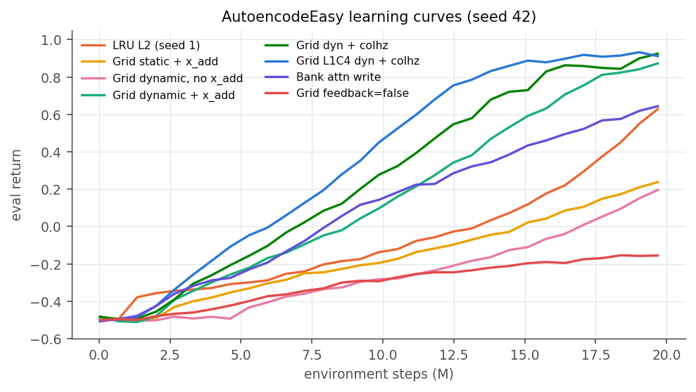
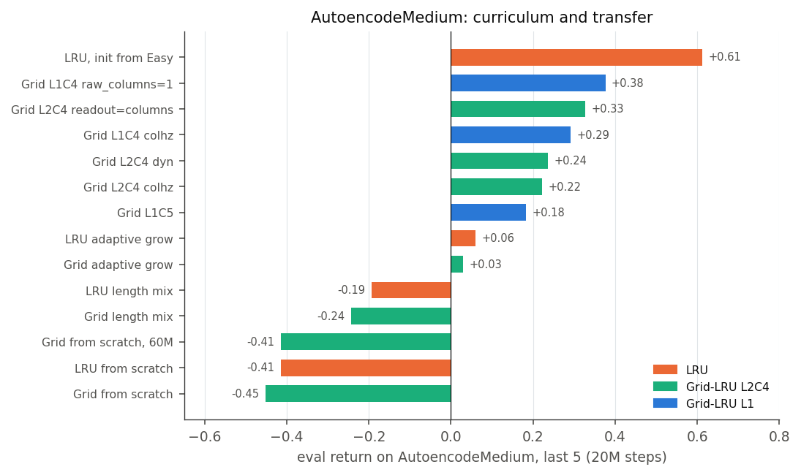
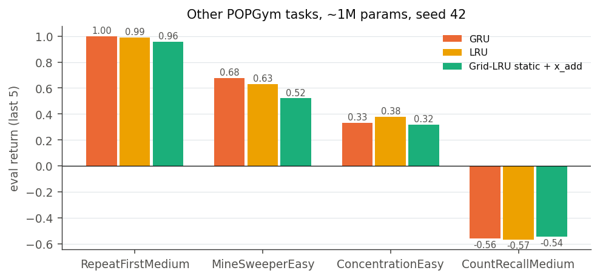

# RL experiments, October 2026 (POPGym card-memory tasks)

This is the follow-up to the negative RL pilot in the AISTATS paper. The goal was to find out why grid models failed on
POPGym and whether a redesigned grid can beat a plain recurrent core in RL. 181 runs, 18 to 26 October 2026, rounds
`p7` to `p31`. All runs: seed 42 unless stated, about 1.0M parameters including the actor-critic heads, Comet project
`knitwork-aistat`, run names `rlfast/p*/...`.

Architectures: [Grid-LRU](methods/grid_lru.md) (all options), [bank](methods/grnn_lru_bank.md),
[many-column](methods/grnn_many.md). Other pages: [Ablations](experiments/ablations.md), [Hypothesis registry](experiments/hypotheses.md).

## Result in brief

| | |
|---|---|
| **Worked** | Grid-LRU with dynamic routing + `x_add` + per-column horizon bands, one layer, four columns. AutoencodeEasy 0.918 eval return against 0.38 for a plain LRU; best supervised (oracle) accuracy on AutoencodeHard (0.513 vs 0.338). |
| **Diagnosed** | The paper pilot failed because (1) RepeatPreviousHard and AutoencodeEasy at that budget were out of reach for every GRU-cell model, and (2) the static grid diluted the observation to about 15% of each column's input. |
| **Did not work** | Transfer to longer episodes: on AutoencodeMedium after Easy pretraining the grid reaches at most 0.38, the plain LRU 0.61. No grid variant beats LRU or GRU on RepeatFirst, MineSweeper, Concentration or CountRecall. |
| **Infrastructure** | GPU-vectorized POPGym card tasks + PPO with CUDA graphs: 130 to 10k-36k environment steps per second. |

## Setup

### Fast pipeline

- `knitwork/env/popgym_torch.py`: POPGym card-memory tasks (Autoencode, RepeatPrevious, RepeatFirst, CountRecall,
  Concentration, MineSweeper, Battleship adapters) as batched torch environments on the GPU. Tested equal to the
  reference `popgym` implementation.
- `knitwork/rl/ppo_gpu.py`: recurrent PPO with the whole rollout and update captured in CUDA graphs. Optional
  supervised "oracle" mode (`rl.supervised=true`) trains the same network with cross-entropy on the correct action.
- `knitwork/exps/mikasa/run_fast.py` + `config/fast/base.yaml`: runner with checkpoints, pause and resume
  (`run_fast_queue.sh <queue file>`).

PPO: 256 environments, rollout 128, lr 3e-4, 4 epochs x 4 minibatches, gamma 0.99, GAE 0.95, clip 0.2, entropy 0.01.

### Protocol (from round p22)

Every architecture hypothesis was tested on a fixed three-part protocol:

1. **RL AutoencodeEasy**, 20M steps: can PPO learn to memorize and replay a deck?
2. **Oracle AutoencodeHard**, 5M steps, supervised: memory capacity without the RL signal (accuracy at 4.6M steps).
3. **AutoencodeMedium, initialized from the Easy checkpoint**, 20M steps: transfer to longer episodes.

Metric: greedy evaluation return (`Eval`, 512 episodes), mean of the last five evaluations; maximum 1.0, random policy
about -0.5. Oracle metric: sampled-action accuracy, mean of the last five prints at or before 4.6M steps.

## Rounds

| Round | Question | Outcome |
|---|---|---|
| p7-p8 | Grid-LRU (static + `x_add`) vs GRU / LRU on six POPGym tasks | grid never better (figure below) |
| p9 | sparse top-k writes (`write_topk`) | **fails**: router collapses onto fixed columns (oracle .28 / .74 vs `x_add` .975) |
| p10 | dynamic routing; selective (input-dependent) decay | dynamic **wins** on AE Easy (.821 vs LRU .37); selective decay negative everywhere |
| p11 | hypothesis sweep: table routing, extra rounds, read attention, state-addressed writes with balancing, input gates, GRU columns, ordinal policy | only dynamic routing holds; `table` control .102 shows that content-dependent weights matter |
| p12-p13 | multi-round communication, C8, input to all layers, top-2 routes, **column horizon bands** | horizon bands **win** (.875, confirmed on 3 seeds .875/.847/.867) |
| p14 | seeds for horizon bands and top-2 | bands stable; top-2 adds nothing |
| p16 | aux loss on past observations; routing entropy term | aux neutral; entropy both directions hurts |
| p17-p21 | curriculum and transfer to AutoencodeMedium/Hard; BPTT 256; readout over columns; length mixing; adaptive deck growth | grid transfers worse than LRU (.22 vs .61); BPTT and readout do not explain it |
| p22 | **cardinal round**: bank of independent LRUs with attention read / soft content-addressed write; feed-forward-in-time routing | all three **rejected**; best bank (attention write) .593 RL / .386 oracle |
| p23 | bank refinements (feedback into write query, 4 heads) | no gain; bank family abandoned |
| p24 | soft write allocation in the grid; state-based routing queries | both worse (.198, .797) |
| p25 | clockwork layers; time-addressed snapshot memory slots | both fail (-.083, .285) |
| p26 | LRU backbone + grid; shared column weights; **one layer (L1C4)** | **L1C4 best ever**: .918 RL, .513 oracle |
| p27 | L1 refinements: C6, no bands, readout over columns | all worse than L1C4 |
| p28-p30 | raw LRU stream column, linear cell output, no feedback; raw x2; C5 | raw column helps transfer once (.376) but does not replicate (C5 raw .052); no feedback breaks everything |
| p31 | many cheap columns: 16 shared-weight columns with full / top-k active / workspace / group communication (0.31-0.47M) | all far below L1C4 (best .259); paused after M3 |

## Main comparison (same scale, ~1M parameters)



| Model | RL AE Easy | AEM after Easy | Oracle AEH @4.6M |
|---|---:|---:|---:|
| LRU L2 (H358) | 0.37 (seed 42), 0.46 / 0.30 (seeds 1, 2) | **0.612** | 0.338 |
| Grid L2C4 static + `x_add` | 0.175 | --- | --- |
| Grid L2C4 dynamic + `x_add` (H160) | 0.821 | 0.237 | 0.430 |
| Grid L2C4 dynamic + `x_add` + bands | 0.875 | 0.222 | 0.461 |
| **Grid L1C4 dynamic + `x_add` + bands (H224)** | **0.918** | 0.292 | **0.513** |
| Bank, attention write | 0.586 | --- | 0.386 |

The seed-42 LRU AutoencodeEasy value (0.369) comes from the p10 Comet run; its stdout log was not kept, the other values
are recomputed from `logs/run_fast/*.log` into [rl_2026-10_runs.json](experiments/rl_2026-10_runs.json ":ignore").

## All AutoencodeEasy variants





The curves show the two failure modes. Without `x_add` or with a static table, learning starts late and plateaus near
0.1-0.2. Without the recurrent feedback (`feedback=false`) it never leaves the random level. The winning grids pass the
LRU at about 6M steps and approach 0.9.

## Transfer to longer episodes (not solved)



| Approach | Grid | LRU |
|---|---:|---:|
| from scratch, 20M | -0.452 | -0.415 |
| from scratch, 60M | -0.414 | --- |
| BPTT 256 | -0.435 | -0.369 |
| mixed deck lengths | -0.244 | -0.193 |
| adaptive deck growth | 0.029 | 0.060 |
| init from Easy checkpoint | 0.222 to 0.376 (best: L1C4 raw column) | **0.612** |

From scratch nothing learns AutoencodeMedium. Curriculum from the Easy checkpoint works for both, but the LRU transfers
about twice as well. Checked and excluded as the cause: BPTT window, readout, column width (C2), nonlinear cell output,
horizon bands (learned horizons are almost identical in grid and LRU, median ~32, 90th percentile ~500 steps). The
raw-stream column gain (0.376) did not replicate with five columns, so the transfer metric is likely noisy at one seed.
AutoencodeHard after curriculum: LRU 0.34, grid -0.24 to -0.04.

## Other POPGym tasks



| Task | GRU | LRU | Grid-LRU static + `x_add` |
|---|---:|---:|---:|
| RepeatFirstMedium | **1.000** | 0.990 | 0.958 |
| MineSweeperEasy | **0.677** | 0.632 | 0.522 |
| ConcentrationEasy | 0.333 | **0.380** | 0.318 |
| CountRecallMedium | -0.557 | -0.565 | -0.544 |
| BattleshipEasy | -0.338 | --- | --- |

These ran before dynamic routing existed (p7-p8). The later dynamic grid also stayed below LRU on ConcentrationEasy
(0.254 vs 0.38). CountRecallMedium fails for everyone in RL, but the oracle LRU learns it (0.678 accuracy): CountRecall
is an RL-signal problem, not a memory-capacity problem.

## Hypotheses tested

**Confirmed (adopted):**

- `x_add`: the observation must reach every layer-0 column directly. Static softmax routing gave it about 15% weight.
- Dynamic query-key routing between columns, with queries from the previous column outputs.
- Per-column horizon bands (`column_horizons`): each column owns a range of memory timescales. Works only together with
  dynamic routing; band order is irrelevant.
- One layer of four columns beats two layers, two wide columns, and five to eight columns at the same budget.
- Recurrent feedback of the top outputs into the routing sources is essential (removing it: -0.16).
- Inter-column routing must be recurrent and state-dependent: every attempt to move communication out of the recurrence
  (bank with attention read, feed-forward routing) lost.

**Rejected:**

- Sparse top-k writes (router collapse), soft write allocation, state-addressed writes with load balancing.
- Selective (input-dependent) decay of the LRU.
- Extra communication rounds per step (monotonically worse: 1 > 2 > 3 rounds).
- Routing entropy bonus or penalty; auxiliary prediction of past observations (neutral).
- Bank of independent LRUs with read-only attention (= LRU), with soft content-addressed writes (0.59), and refinements.
- Clockwork layer strides, time-addressed snapshot memory slots.
- LRU backbone in front of the grid, two raw LRU stream columns, readout over all columns in the one-layer grid.
- Many cheap shared-weight columns (C16) with full, top-k active, workspace or group communication.

**Open:**

- Why the grid transfers worse than the LRU from Easy to Medium.
- Whether the single-seed gains of L1C4 over L2C4 (0.918 vs 0.875) and C5 (0.894) survive more seeds.
- p31: workspace (M3) paused at 13M steps (0.034), groups (M4) and the 0.31M L1C4 control were not run.

## Reproducing

```sh
# one run (logs to Comet project knitwork-aistat)
uv run knitwork/exps/mikasa/run_fast.py knitwork/exps/mikasa/config/fast/base.yaml \
  --model=grnn_lru.L2C4 --grnn_lru_L2C4.n_layers=1 --grnn_lru_L2C4.hidden_size=224 \
  --grnn_lru_L2C4.routing=dynamic --grnn_lru_L2C4.x_add=true --grnn_lru_L2C4.column_horizons=true \
  --env=AutoencodeEasy --n_steps=20e6
# a whole round
bash knitwork/exps/mikasa/run_fast_queue.sh knitwork/exps/mikasa/config/fast/queue_p25_arch.txt   # p25 + p26
# figures and the run summary json
uv run python inference/docs_figures_2026_10.py
```
