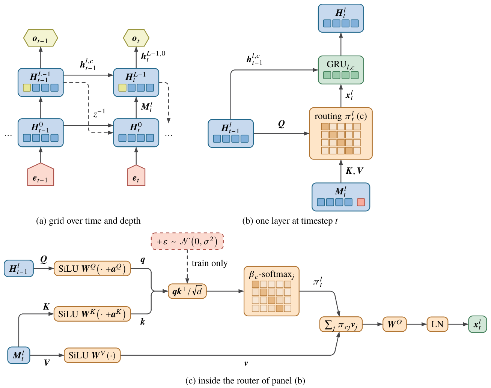

# Grid-GRU (MoSAIC): detailed architecture

Grid-GRU is the main architecture of the AISTATS 2027 submission, called **MoSAIC** in the paper. The implementation is
`knitwork/models/grnn_core.py` (`GridRnn`), selected with `--model=grnn`. This page covers the full forward pass, the
router, the regularizers, the state and compute accounting, and the configurations behind the paper tables. The code-level
reference with the bank and router class variants is [grnn_core](methods/grnn_core.md). Results are on
[AISTATS 2027 results](experiments/aistats2027_results.md) and [Ablations](experiments/ablations.md).



## Idea in one paragraph

A standard GRU keeps all memory in one wide vector. Every input step rewrites that vector through a dense update, so
unrelated pieces of information interfere with each other. Grid-GRU splits the recurrent state into an `L x C` grid of
narrow, **independent GRU cells**: `L` layers (depth inside one time step) and `C` columns (parallel memories). Cells never
share weights or state directly. The only way information moves between columns is a **learned attention router**: at
every layer and step, each column picks a soft mixture of sources (the other columns and the external input) and uses
that mixture as its GRU input. Columns that are not addressed keep their content almost unchanged, because a GRU whose
input carries no new evidence can hold its state through its update gate. The cost per token stays constant with
sequence length (no KV cache), unlike a Transformer.

## State

```python
h    # [L, C, B, H]  hidden state of every cell
out  # [C, B, H]     h[-1]: the top-layer outputs, the message pool of the next step
```

At about 1M parameters (L2C4, `H = 136`) the carried state is `L * C * H = 1088` floats (4.25 KiB); a GRU of the same
size carries 404 to 696 floats, a Transformer-256 360k floats of KV cache (see the state table in
[AISTATS results](experiments/aistats2027_results.md?id=1m-parameters-text8)).

## One step

The token embedding `x` has the same width `H` as a cell (`TokenModel` sets `embedding_size = hidden_size`).

```python
msg = cat([state['out'], x], dim=0)          # [C + 1, B, H]: previous top outputs + external input
for l in range(L):
    u, info = router[l](q=h[l], k=msg, v=msg)  # [C, B, H]: one message per column
    h_new[l] = gru_bank(l, u, h[l])            # C independent GRU cells, batched matmuls
    msg = h_new[l]                             # the next layer routes over this layer's outputs
y = h_new[-1][0]                             # readout: column 0 of the top layer
state = {'h': h_new, 'out': h_new[-1]}
```

Three properties follow from this loop:

1. **Depth is within-step computation.** Layer `l` reads layer `l - 1` at the same time step. Depth works like the
   layers of an MLP. It does not add memory horizon.
2. **Recurrence closes through the top.** Layer 0 reads `state['out']`, the top layer's previous output. The top layer
   feeds back into the bottom with a delay of one step. This is the only path from depth to temporal depth.
3. **The input is a source, not a destination.** The router has `C` queries but `C + 1` keys and values. The external input
   is one extra token that any column may read and no column writes.

### Readout

The prediction comes from column 0 of the top layer only (`column0`). The rest of the grid influences the output only
through routing into column 0. That bottleneck is deliberate: it forces the other columns to act as memory for column 0
instead of as extra output features. The communication study (below) also tests a `mean` readout over all top columns.

## Router (`StochasticMessagePassingLayer`, `mha=2`)

The router uses the weights of `nn.MultiheadAttention` but runs the math by hand so that the routing distribution is
exposed:

```python
q = q + ids[0]; k = k + ids[1]                    # learned column identities: "column 3" becomes a stable address
q, k, v = silu(W_q q + b_q), silu(W_k k + b_k), silu(W_v v + b_v)
logits = q @ k.T / sqrt(head_dim)                 # 4 heads
logits += noise_std * randn_like(logits)          # train only: exploration over routes
pi = softmax(softplus(pi_logtemp) * logits)       # learned inverse temperature per receiving column
msg = LayerNorm(W_o (pi @ v))                     # the message is the GRU input, not a residual
```

- **Queries come from the cell's own previous state** `h[l]`, so a column asks according to what it already holds.
  Routing is therefore content- and history-dependent (dynamic).
- **Identity initialization.** `W_v = I` and `W_o = I + small noise`. At step zero a message is (a SiLU of) the
  selected column's state, not a random projection of it.
- **Per-column temperature.** `pi_logtemp` has shape `[1, 1, C, 1]`. Each receiving column learns how sharply it
  routes; it starts as an ordinary softmax.

## GRU bank (`bank=2`)

`GruBank2` evaluates the `L x C` cells with batched matmuls over the column dimension. It is mathematically equal to
`nn.GRUCell` and uses its initialization:

```python
rz = sigmoid(cat(x, h) @ W_rz + b_rz)   # [C, B, 2H]: reset and update gates
r, z = rz.chunk(2, -1)
n = tanh(cat(x, r * h) @ W_n + b_n)     # candidate
h = (h - n) * z + n                     # == (1 - z) * n + z * h
```

Each column has its own weights: `L * C * (6H^2 + 3H)` parameters in the cells, plus about `4H^2` per layer in the router
projections.
Widths at the same total budget therefore shrink as `C` grows (H = 140 for L1C8, 96 for L2C8 at ~1M).

## Communication regularizers (paper configuration)

The original AAAI configuration added three regularizers. They are computed by the router in training mode and weighted by
the runner:

```python
prob_comm = 1 - diag(pi)                          # cost of talking: mass not sent to self
comm_loss = prob_comm + pi[..., -1] * (2 * c - 1) # input access: rewarded for column 0, penalized for c >= 1
entropy = normalized H(pi)                        # bonus against early route collapse
loss = task + 0.05 * comm_loss - 0.005 * entropy  # plus logit noise noise_std = 0.02 (SDQ) / 0.05 (Text8)
```

The AAAI reviewers asked for an ablation of these three terms. The 67M-token pilot (see
[Ablations](experiments/ablations.md?id=grid-gru-regularizers)) showed that removing any one of them changes BPC by less
than 0.005, and removing all three costs +0.002. The "clean" configurations of the communication study switch all three
off.

## Configurations

| Scale | Config | `L` | `C` | `H` | Params | State floats |
|---|---|---:|---:|---:|---:|---:|
| ~1M | `grnn_L1C8` | 1 | 8 | 140 | 1.034M | 1,120 |
| ~1M | `grnn_L2C4` | 2 | 4 | 136 | 1.050M | 1,088 |
| ~1M | `grnn_L2C8` | 2 | 8 | 96 | 0.973M | 1,536 |
| ~1M | `grnn_L3C4` | 3 | 4 | 112 | 1.069M | 1,344 |
| ~10M | `grnn_L1C8` | 1 | 8 | 440 | 10.11M | |
| ~10M | `grnn_L2C4` | 2 | 4 | 424 | 10.11M | |
| ~10M | `grnn_L2C8` | 2 | 8 | 312 | 10.17M | |
| ~10M | `grnn_L2C16` | 2 | 16 | 224 | 10.09M | |
| ~10M | `grnn_L3C4` | 3 | 4 | 344 | 9.99M | |

All use `n_attn_heads: 4`, `bank: 2`, `mha: 2`, `ln_msg: true`. ~1M configs are in `knitwork/exps/{text,sdq}/config/mid.yaml`,
~10M in `large.yaml`. Text8 runs: 1B tokens, BPTT 64.

Compute: dense forward matrix FLOPs are ~3.06 MFLOPs/token for L2C4 at 1M, against ~2.0 for a parameter-matched GRU. The
measured H100 throughput is 172k tokens/s (L2C4) against 253k tokens/s (GRU-L2) at 10M; see
[resources](experiments/aistats2027_results.md?id=training-cost-h100).

## What the experiments say about Grid-GRU

| Claim | Status | Evidence |
|---|---|---|
| Better than a parameter-matched GRU on Text8 at 10M | **supported** (3 seeds, Welch p <= 0.003) | L3C4 1.4345 vs GRU-L3 1.4830 BPC |
| Much better long-range memory than GRU on SDQ at 10M | **supported** | Acc++ 0.920 (L3C4) vs 0.618 (best GRU) |
| Competitive with a Transformer at 1M and 10M on Text8 | **supported, not significant** | 10M: 1.4345 vs 1.4492 (p = 0.165) |
| Better than GRU at 1M | **direction holds, not significant** | 1.5918 vs 1.6205 (p = 0.12, 2-3 seeds) |
| The three regularizers matter | **rejected** | each |delta| < 0.005 BPC in the pilot |
| Content-dependent (dynamic) routing beats a static learned table | **not supported** | Text8 1.6006 vs 1.6004; SDQ static is better |
| Communication between columns is needed | **supported (1 seed)** | none_mean 1.6452 vs static_mean 1.6144 BPC |
| Sparse top-1 routing is enough | **rejected** | top1 1.8869, top2 1.6353, dense 1.5921 BPC |
| Depth > width: L3C4 / L2C4 better than L1C8 | **supported** | 1M: L1C8 is the worst Grid-GRU in both tasks |
| Grid-GRU helps POPGym RL | **not supported** | RepeatPreviousHard -0.494 vs LRU -0.381 |

Mamba (1.5651 at ~1M, 2 seeds) is better than all Grid-GRU configurations on Text8 in the H100 snapshot. The paper
reports it as an outside reference, not as a parameter-matched baseline.
